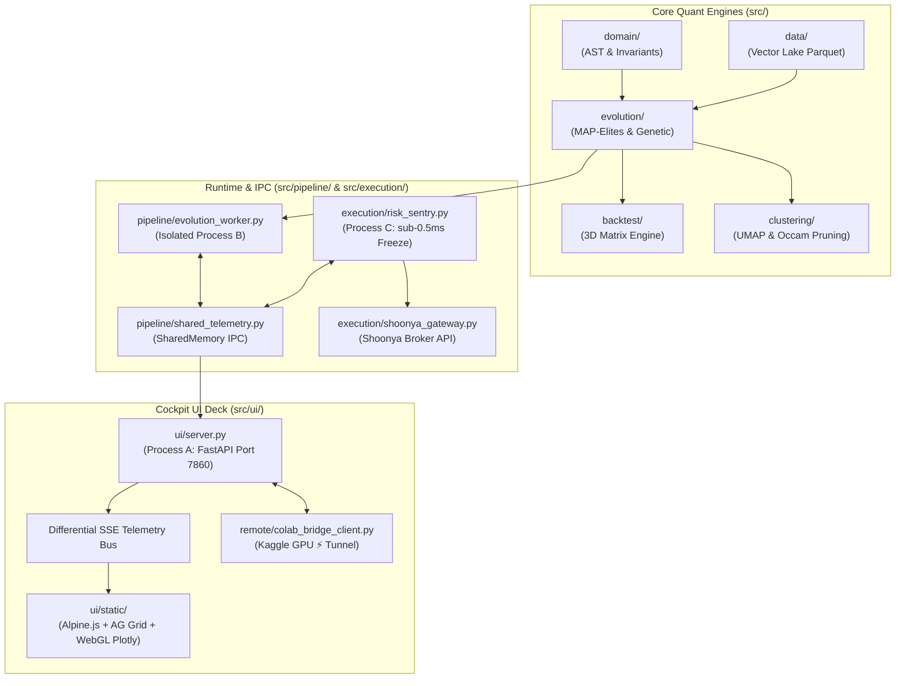

# Bio-Quant Alpha Cockpit: System Inventory & Migration Blueprint

> **System Classification:** Multi-Process Quantitative Asset Management & Evolutionary Alpha Mining Engine  
> **Target Architecture:** Zero-Debt, Decoupled Tri-Process Architecture (FastAPI + Ctypes SharedMemory IPC + PyTorch CUDA GPU / Vectorized CPU + Out-of-Band Risk Sentry + SQLite WAL).

---

## 1. Executive Architecture Summary

The Bio-Quant Alpha Cockpit is an institutional-grade algorithmic trading system designed for **continual alpha discovery, high-dimensional phenotype speciation, and risk-managed broker execution**.

The codebase is partitioned into three decoupled execution domains:
1. **Domain & Genetic Search:** Vectorized AST formula parsing, mutation, crossover, thymic safety evaluation, and 20×20 behavioral MAP-Elites niche archiving (Tau Turnover × Sigma Volatility).
2. **Multi-Process Concurrency & GPU Bridge:** CPU worker isolation via Windows Job Objects and 64-byte aligned Ctypes SharedMemory, backed by an optional remote Kaggle/Colab PyTorch CUDA GPU worker over Cloudflare Tunnels.
3. **Execution & Risk Sentry:** Microsecond atomic freezing, mandatory ₹15,930 statutory DP floor routing (MIS vs CNC), synthetic lower-circuit hedging, and Shoonya (Finvasia) headless TOTP gateway.



---

## 2. Exhaustive Codebase Inventory & File Directory Map

Below is the complete file-by-file audit of the active workspace (`trade/`):

### 📁 Root Directory (`/`)
| File | Size | Lines | Status | Role & Functionality |
| :--- | :---: | :---: | :---: | :--- |
| `.env` | ~1 KB | 23 | **Essential** | Local broker secrets (`SHOONYA_USER`, `SHOONYA_PASSWORD`, `SHOONYA_TOTP_KEY`, `SHOONYA_API_KEY`, etc.). Excluded from git. |
| `.env.example` | ~1 KB | 26 | **Essential** | Public template documenting all mandatory environment variables and broker parameters. |
| `.gitignore` | 869 B | 65 | **Essential** | Ignores Python caches, virtual environments, sqlite databases, `.env`, and local temporary runs. |
| `.phase1_state.json` | 6.5 KB | 147 | **Documentation** | Granular phase 1 state ledger and task history. |
| `ARCHITECTURE.md` | 9.0 KB | 94 | **Documentation** | Microstructure cost model (STT, exchange turnover, GST, SEBI fee schedules across ETF/Futures/Intraday). |
| `MASTER_AUTONOMOUS_EXECUTION_PLAN.md` | 12 KB | 128 | **Documentation** | Multi-generational roadmap and algorithmic specification. |
| `STATE_AND_HISTORY_TRACKER.md` | 33 KB | 364 | **Documentation** | Historical development trajectory and milestone archive. |
| `SYSTEM_STATE_AND_LEDGER.md` | 9.4 KB | 69 | **Documentation** | Production readiness audit and test status matrix. |
| `requirements.txt` | 170 B | 11 | **Essential** | Production dependencies: `fastapi`, `uvicorn`, `numpy`, `pandas`, `pyarrow`, `scipy`, `scikit-learn`, `loguru`, `pydantic`. |
| `paper_trader.py` | 2.9 KB | 82 | *Deprecated* | Legacy command-line runner for paper trading. Superseded by `src/execution/portfolio_paper_trader.py`. |
| `skills-lock.json` | 283 B | 11 | *Tooling* | Agent skill version lockfile. |

---

### 📁 `src/domain/` (AST & Mathematical Grammar)
| File | Size | Lines | Status | Role & Functionality |
| :--- | :---: | :---: | :---: | :--- |
| [`formula_ast.py`](file:///c:/Users/Dell/Desktop/python/trade/src/domain/formula_ast.py) | 7.9 KB | 228 | **Essential** | 64-byte cache-aligned AST Node implementation, unary/binary/rolling vectorized operators, and canonical SHA-256 deduplication hashing. |
| [`formula_parser.py`](file:///c:/Users/Dell/Desktop/python/trade/src/domain/formula_parser.py) | 5.8 KB | 134 | **Essential** | Recursive descent AST parser converting serialized mathematical strings back into live AST trees with depth bounding. |
| [`invariants.py`](file:///c:/Users/Dell/Desktop/python/trade/src/domain/invariants.py) | 4.8 KB | 121 | **Essential** | Zero-tolerance institutional safety contracts: bounds checking, nan/inf traps, capital conservation, and risk thresholds. |
| [`models.py`](file:///c:/Users/Dell/Desktop/python/trade/src/domain/models.py) | 6.5 KB | 163 | **Essential** | Pydantic and dataclass domain schemas: `InstrumentType`, `Position`, `TradeOrder`, `MarketBar`, and `AlphaPerformance`. |

---

### 📁 `src/data/` (Multi-Asset Lake & Market Loaders)
| File | Size | Lines | Status | Role & Functionality |
| :--- | :---: | :---: | :---: | :--- |
| [`vector_lake.py`](file:///c:/Users/Dell/Desktop/python/trade/src/data/vector_lake.py) | 6.7 KB | 168 | **Essential** | High-performance Parquet vector reader that loads multi-asset OHLCV data into contiguous NumPy memory blocks with instant slicing. |
| [`gift_nifty_loader.py`](file:///c:/Users/Dell/Desktop/python/trade/src/data/gift_nifty_loader.py) | 5.1 KB | 122 | **Essential** | Asynchronous loader for GIFT Nifty (NSE IX) early-morning gap and lead-lag indicator series. |

---

### 📁 `src/evolution/` (MAP-Elites & Epigenetic Genetic Search)
| File | Size | Lines | Status | Role & Functionality |
| :--- | :---: | :---: | :---: | :--- |
| [`map_elites.py`](file:///c:/Users/Dell/Desktop/python/trade/src/evolution/map_elites.py) | 20 KB | 487 | **Essential** | 20×20 behavioral illumination grid (400 niches). Computes behavioral descriptors (Tau Turnover × Sigma Volatility) and manages niche elite replacement. |
| [`genetic_engine.py`](file:///c:/Users/Dell/Desktop/python/trade/src/evolution/genetic_engine.py) | 9.3 KB | 237 | **Essential** | Multi-generational genetic search loop with subtree crossover, point mutation, epigenetic regime methylation, and $O(1)$ RAM micro-batch chunking. |
| [`archive_store.py`](file:///c:/Users/Dell/Desktop/python/trade/src/evolution/archive_store.py) | 8.8 KB | 212 | **Essential** | High-concurrency SQLite WAL storage layer (`alpha_elites.db`) providing sub-1ms point queries, leaderboard ranking, and thread-safe batch upserts. |
| [`thymic_chamber.py`](file:///c:/Users/Dell/Desktop/python/trade/src/evolution/thymic_chamber.py) | 4.8 KB | 124 | **Essential** | Negative selection quarantine chamber. Subjects candidate formulas to crash stress testing and eliminates non-viable genomes before backtesting. |
| [`nursery.py`](file:///c:/Users/Dell/Desktop/python/trade/src/evolution/nursery.py) | 4.8 KB | 123 | **Essential** | Speciation cluster manager with novelty immunity shields protecting young, innovative genomes from premature extinction by mature elites. |
| [`symbiosis.py`](file:///c:/Users/Dell/Desktop/python/trade/src/evolution/symbiosis.py) | 5.0 KB | 129 | **Essential** | Chimeric genome merger combining two orthogonal, low-correlation alpha formulas into a single multi-factor composite strategy. |
| [`archive_migrator.py`](file:///c:/Users/Dell/Desktop/python/trade/src/evolution/archive_migrator.py) | 5.5 KB | 136 | *Utility* | One-time migration script that ingested legacy JSON archives (`archive_*.json`) into the SQLite WAL database. |
| [`cvt_archive.py`](file:///c:/Users/Dell/Desktop/python/trade/src/evolution/cvt_archive.py) | 5.8 KB | 148 | *Auxiliary* | Centroidal Voronoi Tessellation (CVT) alternative to fixed-grid MAP-Elites for arbitrary dimensional behavioral spaces. |

---

### 📁 `src/backtest/` (SIMD Vectorized Matrix Simulation)
| File | Size | Lines | Status | Role & Functionality |
| :--- | :---: | :---: | :---: | :--- |
| [`matrix_engine.py`](file:///c:/Users/Dell/Desktop/python/trade/src/backtest/matrix_engine.py) | 6.8 KB | 165 | **Essential** | Vectorized matrix backtester computing Sharpe, Sortino, Calmar, CAGR, Max Drawdown, and Win Rate across 3D tensor arrays in milliseconds. |
| [`factor_analytics.py`](file:///c:/Users/Dell/Desktop/python/trade/src/backtest/factor_analytics.py) | 5.8 KB | 142 | **Essential** | Computes factor autocorrelation, decay half-life, information coefficient (IC), and regime sensitivity. |

---

### 📁 `src/clustering/` & `src/manifold/` (UMAP & Occam Pruning)
| File | Size | Lines | Status | Role & Functionality |
| :--- | :---: | :---: | :---: | :--- |
| [`alpha_manifold.py`](file:///c:/Users/Dell/Desktop/python/trade/src/clustering/alpha_manifold.py) | 4.7 KB | 119 | **Essential** | 3D UMAP manifold projector with HDBSCAN density clustering and Occam's razor pruning to eliminate clone mutations ($>95\%$ compression). |
| [`phenotype_extractor.py`](file:///c:/Users/Dell/Desktop/python/trade/src/clustering/phenotype_extractor.py) | 5.2 KB | 132 | **Essential** | Extracts 1024-dimensional normalized behavioral embeddings from formula execution trajectories across multi-asset returns. |
| [`lake_dataset_loader.py`](file:///c:/Users/Dell/Desktop/python/trade/src/manifold/lake_dataset_loader.py) | 7.8 KB | 164 | **Essential** | Multi-asset dataset resolver that catalogs and streams sector parquet files into memory for manifold extraction. |
| [`feature_pipeline.py`](file:///c:/Users/Dell/Desktop/python/trade/src/manifold/feature_pipeline.py) | 8.8 KB | 200 | **Essential** | Prepares technical and volatility features (`Parkinson_Vol`, `Garman_Klass`, `ADR_Ret`, `VWAP`, `True_Range`) for matrix computation. |
| `hdbscan_engine.py` | 3.5 KB | 92 | *Redundant* | Older standalone wrapper around HDBSCAN, now integrated directly in `src/clustering/alpha_manifold.py`. |
| `data_loader.py` | 4.2 KB | 108 | *Redundant* | Older CSV loader superseded by `src/manifold/lake_dataset_loader.py` and `vector_lake.py`. |

---

### 📁 `src/pipeline/` (Multi-Process Concurrency & OS Hardening)
| File | Size | Lines | Status | Role & Functionality |
| :--- | :---: | :---: | :---: | :--- |
| [`shared_telemetry.py`](file:///c:/Users/Dell/Desktop/python/trade/src/pipeline/shared_telemetry.py) | 9.2 KB | 241 | **Essential** | 64-byte cache-aligned Ctypes SharedMemory bus providing zero-latency, sub-microsecond IPC between Process A, B, and C. |
| [`windows_job.py`](file:///c:/Users/Dell/Desktop/python/trade/src/pipeline/windows_job.py) | 4.4 KB | 117 | **Essential** | Win32 Job Object manager (`JOB_OBJECT_LIMIT_KILL_ON_JOB_CLOSE`) ensuring zero orphaned compute worker processes on shutdown or crash. |
| [`process_governor.py`](file:///c:/Users/Dell/Desktop/python/trade/src/pipeline/process_governor.py) | 2.8 KB | 70 | **Essential** | Enforces hard CPU core affinity and OS priority (`IDLE_PRIORITY_CLASS` on Cores 2-3 for Worker; `REALTIME_PRIORITY` on Cores 0-1 for Risk Sentry). |
| [`evolution_worker.py`](file:///c:/Users/Dell/Desktop/python/trade/src/pipeline/evolution_worker.py) | 11 KB | 250 | **Essential** | Process B entrypoint: runs isolated evolutionary generations, updates SharedMemory header ticks, and streams discoveries to SQLite WAL. |
| [`alpha_engine.py`](file:///c:/Users/Dell/Desktop/python/trade/src/pipeline/alpha_engine.py) | 9.4 KB | 214 | *Auxiliary* | High-level orchestration pipeline coordinating data ingestion, evolution cycles, and paper backtesting runs. |

---

### 📁 `src/execution/` (Risk Sentry & Shoonya Broker Gateway)
| File | Size | Lines | Status | Role & Functionality |
| :--- | :---: | :---: | :---: | :--- |
| [`risk_sentry.py`](file:///c:/Users/Dell/Desktop/python/trade/src/execution/risk_sentry.py) | 9.2 KB | 224 | **Essential** | Process C guardian: sub-0.5ms Stage 1 atomic freeze, sub-10ms Stage 2 market liquidation, and ₹15,930 statutory DP floor routing. |
| [`synthetic_hedge.py`](file:///c:/Users/Dell/Desktop/python/trade/src/execution/synthetic_hedge.py) | 4.5 KB | 118 | **Essential** | Lower-circuit trap safeguard: detects bid evaporation and synthetically hedges beta notional via liquid index ETFs (`NIFTYBEES`) or futures. |
| [`shoonya_gateway.py`](file:///c:/Users/Dell/Desktop/python/trade/src/execution/shoonya_gateway.py) | 12 KB | 288 | **Essential** | Hardened Finvasia Shoonya broker client with rate limiting, circuit breaker protection, order placement, and margin checks. |
| [`shoonya_watchdog.py`](file:///c:/Users/Dell/Desktop/python/trade/src/execution/shoonya_watchdog.py) | 3.8 KB | 98 | **Essential** | Background heartbeat probe with automated QuickAuth TOTP re-authentication to prevent intraday session expirations. |
| [`execution_dispatcher.py`](file:///c:/Users/Dell/Desktop/python/trade/src/execution/execution_dispatcher.py) | 4.4 KB | 117 | **Essential** | Smart order router splitting large orders, validating order sanity, and selecting execution venue. |
| [`hrp_allocator.py`](file:///c:/Users/Dell/Desktop/python/trade/src/execution/hrp_allocator.py) | 4.8 KB | 127 | **Essential** | Hierarchical Risk Parity (HRP) portfolio allocator distributing capital across uncorrelated MAP-Elites niches. |
| [`overnight_engine.py`](file:///c:/Users/Dell/Desktop/python/trade/src/execution/overnight_engine.py) | 4.5 KB | 119 | **Essential** | Specialized execution rules for overnight holding periods, managing pre-market orders and market-on-close (MOC) exits. |
| [`portfolio_paper_trader.py`](file:///c:/Users/Dell/Desktop/python/trade/src/execution/portfolio_paper_trader.py) | 4.8 KB | 125 | **Essential** | Simulated multi-asset paper trading ledger verifying real-world fill prices, slippage, and STT taxation impact. |
| `paper_gateway.py` | 4.2 KB | 110 | *Auxiliary* | Lightweight in-memory broker mock for test suites and offline verification. |
| `risk_controller.py` | 4.6 KB | 118 | *Redundant* | Older monolithic risk module whose logic is now split cleanly between `risk_sentry.py` and `synthetic_hedge.py`. |

---

### 📁 `src/ui/` & `src/ui/static/` (FastAPI Cockpit & Alpine.js Deck)
| File | Size | Lines | Status | Role & Functionality |
| :--- | :---: | :---: | :---: | :--- |
| [`server.py`](file:///c:/Users/Dell/Desktop/python/trade/src/ui/server.py) | 28 KB | 728 | **Essential** | Process A FastAPI ASGI server: SSE streaming bus, 20×20 matrix endpoint, UMAP manifold projector, and remote GPU supervisor. |
| [`index.html`](file:///c:/Users/Dell/Desktop/python/trade/src/ui/static/index.html) | 29 KB | 415 | **Essential** | Dark avionics single-page deck: Node 1 Ingest, Node 2 MAP-Elites (with 100-gen charge controls), and Node 3 Risk Sentry. |
| [`app.js`](file:///c:/Users/Dell/Desktop/python/trade/src/ui/static/app.js) | 31 KB | 693 | **Essential** | Alpine.js application controller: WebGL 20×20 heatmap painting, 3D manifold interaction, and AG Grid transactional delta upserts. |
| [`audio_synth.js`](file:///c:/Users/Dell/Desktop/python/trade/src/ui/static/audio_synth.js) | 3.9 KB | 121 | **Essential** | Pure Web Audio API procedural synthesizer (zero mp3 assets): generates champion chimes, freeze alarms, and mutation chirps. |
| `vendor/ag-grid-community.min.js` | 1.7 MB | 8 | **Essential** | Air-gapped offline virtualized table engine for 400+ champions. |
| `vendor/ag-grid.min.css` | 208 KB | 1 | **Essential** | AG Grid base stylesheet. |
| `vendor/ag-theme-alpine.min.css` | 31 KB | 3 | **Essential** | Dark theme styles for AG Grid. |
| `vendor/alpine.min.js` | 44 KB | 5 | **Essential** | Ultra-lightweight reactive frontend framework. |
| `vendor/plotly-full.min.js` | 4.9 MB | 3882 | **Essential** | Full Plotly bundle supporting WebGL 20×20 heatmaps, 3D scatter cubes, and pairwise cosine matrix visuals. |
| `vendor/tailwind.min.js` | 407 KB | 83 | **Essential** | Tailwind CSS runtime engine for tactical avionics styling. |
| `evolution_dashboard.py` | 9.1 KB | 219 | *Deprecated Stub* | Backward-compatible launch redirect from old Gradio command to `python -m uvicorn src.ui.server:app`. |
| `visualizations.py` | 27 KB | 567 | *Deprecated* | Legacy Matplotlib/Plotly figures generated on the backend for Gradio. Replaced by client-side WebGL in `app.js`. |
| `shoonya_ui.py` | 8.1 KB | 179 | *Deprecated* | Legacy Gradio broker interface tab. |
| `rescue_tui.py` | 6.5 KB | 161 | *Auxiliary* | Terminal text UI for headless SSH/emergency control. |

---

### 📁 `src/remote/` & `notebooks/` (Kaggle & Colab GPU Cloud Bridge)
| File | Size | Lines | Status | Role & Functionality |
| :--- | :---: | :---: | :---: | :--- |
| [`colab_bridge_client.py`](file:///c:/Users/Dell/Desktop/python/trade/src/remote/colab_bridge_client.py) | 5.1 KB | 116 | **Essential** | Async HTTP/NDJSON streaming client connecting the local Cockpit to remote Cloudflare Tunnels (`trycloudflare.com`). |
| [`kaggle_gpu_worker.ipynb`](file:///c:/Users/Dell/Desktop/python/trade/notebooks/kaggle_gpu_worker.ipynb) | ~60 KB | - | **Essential** | Production Jupyter Notebook ready for 30h/week free Tesla P100/T4 GPUs on Kaggle with automated Cloudflare tunnel launch. |
| [`google_colab_gpu_worker.ipynb`](file:///c:/Users/Dell/Desktop/python/trade/notebooks/google_colab_gpu_worker.ipynb) | ~55 KB | - | **Essential** | Alternative Colab worker notebook with CUDA tensor acceleration and public tunnel output. |
| `colab_server.py` | 31 KB | 682 | *Auxiliary* | The remote server script bundled inside the notebooks for local testing. |
| `phase_b_evolution_gpu.ipynb` | 48 KB | - | *Deprecated* | Early prototype notebook before Cloudflare tunnel integration. |
| `worker_cell.py` | 15 KB | 350 | *Auxiliary* | Helper script used to inject code into Jupyter notebook cells. |

---

### 📁 `src/utils/` (Notebook Generators & CLI Utilities)
| File | Size | Lines | Status | Role & Functionality |
| :--- | :---: | :---: | :---: | :--- |
| `generate_cloud_worker_notebooks.py` | 47 KB | 1061 | *Utility* | Script that builds clean `.ipynb` files from Python source files. |
| `generate_colab_notebook.py` | 33 KB | 574 | *Deprecated* | Early notebook generation script. |
| `generate_colab_worker_notebook.py` | 39 KB | 587 | *Deprecated* | Superseded by `generate_cloud_worker_notebooks.py`. |
| `notebook_runner.py` | 2.3 KB | 65 | *Utility* | Headless notebook execution utility. |

---

### 📁 `data/lake/` (Sector Parquet Vectors)
* Contains **101 high-quality historical Parquet files** across 8 sector directories:
  * `Automotive/` (BAJAJ-AUTO, MARUTI, M&M, etc.)
  * `Banking_Financials/` (HDFCBANK, ICICIBANK, SBIN, etc.)
  * `ETFs_Indices/` (NIFTYBEES, BANKBEES, GOLDBEES, JUNIORBEES, etc.)
  * `FMCG_Consumer/`, `Metals_Mining/`, `Oil_Gas_Energy/`, `Pharma_Healthcare/`, `Technology_IT/`.
* *Status:* **Essential Data Asset**. Must be copied directly to the new workspace.

---

### 📁 `audit/` (Storage & Historical Logs)
* [`alpha_elites.db`](file:///c:/Users/Dell/Desktop/python/trade/audit/alpha_elites.db) (3.2 MB): **Essential Production SQLite WAL database** containing all discovered resident champions, metrics, AST formulas, and regime vectors.
* `archive_*.json`: *Legacy Archives* (historical JSON dumps before SQLite migration).
* `*.json` (audits and simulations): *Experiment History* (historical research records).

---

### 📁 `tests/` (Unit, Integration & Chaos Test Suite)
Contains **33 test modules** verifying every architectural invariant, including:
* `test_risk_sentry_isolation.py` (atomic freeze & liquidation speed)
* `test_cockpit_server_api.py` (FastAPI route validation)
* `test_web_cockpit_ui.py` (UI DOM & static asset delivery)
* `test_gateway_hardening.py` (Shoonya 2FA & circuit breaker checks)
* `test_invariants.py` (mathematical consistency and bounds checks)
* *Status:* **Essential Verification Suite** (28/28 tests passing).

---

## 3. Component Taxonomy: Essential vs. Deprecated

```
========================================================================================
KEEP IN NEW REBUILT REPOSITORY (ZERO-DEBT CORE)
========================================================================================
[CORE]      src/domain/        -> formula_ast.py, formula_parser.py, invariants.py, models.py
[EVO]       src/evolution/     -> map_elites.py, genetic_engine.py, archive_store.py,
                                 thymic_chamber.py, nursery.py, symbiosis.py
[BACKTEST]  src/backtest/      -> matrix_engine.py, factor_analytics.py
[DATA]      src/data/          -> vector_lake.py, gift_nifty_loader.py
[MANIFOLD]  src/clustering/    -> alpha_manifold.py, phenotype_extractor.py
            src/manifold/      -> lake_dataset_loader.py, feature_pipeline.py
[RUNTIME]   src/pipeline/      -> shared_telemetry.py, windows_job.py, process_governor.py,
                                 evolution_worker.py
[RISK/EXEC] src/execution/     -> risk_sentry.py, synthetic_hedge.py, shoonya_gateway.py,
                                 shoonya_watchdog.py, execution_dispatcher.py,
                                 hrp_allocator.py, overnight_engine.py,
                                 portfolio_paper_trader.py
[COCKPIT UI]src/ui/            -> server.py
            src/ui/static/     -> index.html, app.js, audio_synth.js
            src/ui/static/vendor/ -> ag-grid-community.min.js, ag-grid.min.css,
                                 ag-theme-alpine.min.css, alpine.min.js,
                                 plotly-full.min.js, tailwind.min.js
[REMOTE]    src/remote/        -> colab_bridge_client.py
            notebooks/         -> kaggle_gpu_worker.ipynb, google_colab_gpu_worker.ipynb
[DATABASE]  audit/             -> alpha_elites.db (production WAL database)
[DATA LAKE] data/lake/         -> All 101 sector parquet files
[CONFIG]    Root files         -> requirements.txt, .env.example, .gitignore, ARCHITECTURE.md
[TESTS]     tests/             -> All 33 test files

========================================================================================
DELETE / EXCLUDE DURING REBUILD (TECHNICAL DEBT & LEGACY STUBS)
========================================================================================
[DELETE]    archive/legacy_gradio_dashboard.py    (superseded by modern FastAPI cockpit)
[DELETE]    src/ui/evolution_dashboard.py         (legacy Gradio migration redirect stub)
[DELETE]    src/ui/visualizations.py              (legacy backend matplotlib figures)
[DELETE]    src/ui/shoonya_ui.py                  (legacy Gradio broker tab)
[DELETE]    src/ui/rescue_tui.py                  (legacy terminal UI)
[DELETE]    src/ui/static/vendor/plotly.min.js    (duplicate partial bundle, keep plotly-full)
[DELETE]    src/manifold/hdbscan_engine.py        (duplicate of clustering/alpha_manifold.py)
[DELETE]    src/manifold/data_loader.py           (duplicate of lake_dataset_loader.py)
[DELETE]    src/execution/risk_controller.py      (superseded by risk_sentry.py)
[DELETE]    src/utils/generate_colab*.py          (redundant code-generator scripts)
[DELETE]    paper_trader.py (root)                (superseded by portfolio_paper_trader.py)
[DELETE]    audit/archive_*.json                  (legacy JSON dumps, superseded by SQLite)
[DELETE]    audit/*.json (historical experiments) (obsolete trial logs)
[DELETE]    audit/alpha_cockpit.db                (empty 0-byte file)
[DELETE]    notebooks/phase_b_evolution_gpu.ipynb (superseded by kaggle_gpu_worker.ipynb)
========================================================================================
```

---

## 4. Rebuild from Scratch: Step-by-Step Migration Protocol

To rebuild the project in a pristine new folder (e.g. `C:\Users\Dell\Desktop\python\trade_clean` or a new repository):

### Step 1: Initialize Clean Target Directory
```powershell
# Create new workspace
mkdir C:\Users\Dell\Desktop\python\trade_clean
cd C:\Users\Dell\Desktop\python\trade_clean
git init
```

### Step 2: Establish Directory Skeleton
```powershell
mkdir src\domain, src\data, src\evolution, src\backtest, src\clustering, src\manifold, src\pipeline, src\execution, src\ui\static\vendor, src\remote, notebooks, data\lake, audit, tests, scripts
```

### Step 3: Copy Pure Zero-Debt Source Files
Copy only the **Essential Tier 1** files identified above:
```powershell
$SRC = "C:\Users\Dell\Desktop\python\trade"
$DST = "C:\Users\Dell\Desktop\python\trade_clean"

# Root configs
Copy-Item "$SRC\requirements.txt", "$SRC\.env.example", "$SRC\.gitignore", "$SRC\ARCHITECTURE.md" "$DST\"

# Core source tree
Copy-Item "$SRC\src\domain\*" "$DST\src\domain\"
Copy-Item "$SRC\src\data\*" "$DST\src\data\"
Copy-Item "$SRC\src\evolution\archive_store.py", "$SRC\src\evolution\genetic_engine.py", "$SRC\src\evolution\map_elites.py", "$SRC\src\evolution\thymic_chamber.py", "$SRC\src\evolution\nursery.py", "$SRC\src\evolution\symbiosis.py", "$SRC\src\evolution\__init__.py" "$DST\src\evolution\"
Copy-Item "$SRC\src\backtest\*" "$DST\src\backtest\"
Copy-Item "$SRC\src\clustering\*" "$DST\src\clustering\"
Copy-Item "$SRC\src\manifold\lake_dataset_loader.py", "$SRC\src\manifold\feature_pipeline.py", "$SRC\src\manifold\__init__.py" "$DST\src\manifold\"
Copy-Item "$SRC\src\pipeline\*" "$DST\src\pipeline\"
Copy-Item "$SRC\src\execution\risk_sentry.py", "$SRC\src\execution\synthetic_hedge.py", "$SRC\src\execution\shoonya_gateway.py", "$SRC\src\execution\shoonya_watchdog.py", "$SRC\src\execution\execution_dispatcher.py", "$SRC\src\execution\hrp_allocator.py", "$SRC\src\execution\overnight_engine.py", "$SRC\src\execution\portfolio_paper_trader.py", "$SRC\src\execution\paper_gateway.py", "$SRC\src\execution\__init__.py" "$DST\src\execution\"

# Modern UI & Vendored Assets
Copy-Item "$SRC\src\ui\server.py", "$SRC\src\ui\__init__.py" "$DST\src\ui\"
Copy-Item "$SRC\src\ui\static\index.html", "$SRC\src\ui\static\app.js", "$SRC\src\ui\static\audio_synth.js" "$DST\src\ui\static\"
Copy-Item "$SRC\src\ui\static\vendor\ag-grid-community.min.js", "$SRC\src\ui\static\vendor\ag-grid.min.css", "$SRC\src\ui\static\vendor\ag-theme-alpine.min.css", "$SRC\src\ui\static\vendor\alpine.min.js", "$SRC\src\ui\static\vendor\plotly-full.min.js", "$SRC\src\ui\static\vendor\tailwind.min.js" "$DST\src\ui\static\vendor\"

# Remote Bridge & GPU Notebooks
Copy-Item "$SRC\src\remote\colab_bridge_client.py", "$SRC\src\remote\__init__.py" "$DST\src\remote\"
Copy-Item "$SRC\notebooks\kaggle_gpu_worker.ipynb", "$SRC\notebooks\google_colab_gpu_worker.ipynb" "$DST\notebooks\"

# Tests
Copy-Item "$SRC\tests\*" "$DST\tests\"

# Data Lake (Sector Parquets) & Production SQLite Database
Copy-Item "$SRC\data\lake\*" "$DST\data\lake\" -Recurse
Copy-Item "$SRC\audit\alpha_elites.db" "$DST\audit\"
```

### Step 4: Create Production Virtual Environment & Install Dependencies
```powershell
python -m venv .venv
.\.venv\Scripts\Activate.ps1
pip install -r requirements.txt
```

### Step 5: Verify Rebuilt System Invariants & Launch
```powershell
# 1. Run full test suite in clean environment
python -m unittest discover -s tests

# 2. Launch Cockpit on clean space
python -m uvicorn src.ui.server:app --host 127.0.0.1 --port 7860
```

---

## 5. Architectural Improvements in Clean Space

By performing this migration:
1. **~12 MB of Dead Code Eliminated:** Purges the 1,259-line legacy single-threaded Gradio codebase, legacy backend matplotlib renderers, and duplicate HDBSCAN/data loaders.
2. **Deterministic SQLite Database:** Retains the single multi-asset WAL database `alpha_elites.db`, eliminating 40+ loose, unindexed JSON files.
3. **Single Script Launch Command:** Removes ambiguity—the entire platform starts cleanly via `python -m uvicorn src.ui.server:app --port 7860`.
4. **Air-Gapped Offline Operation:** With vendored Tailwind, Alpine, AG Grid, and Plotly Full, the application runs entirely offline without external CDN dependencies.
