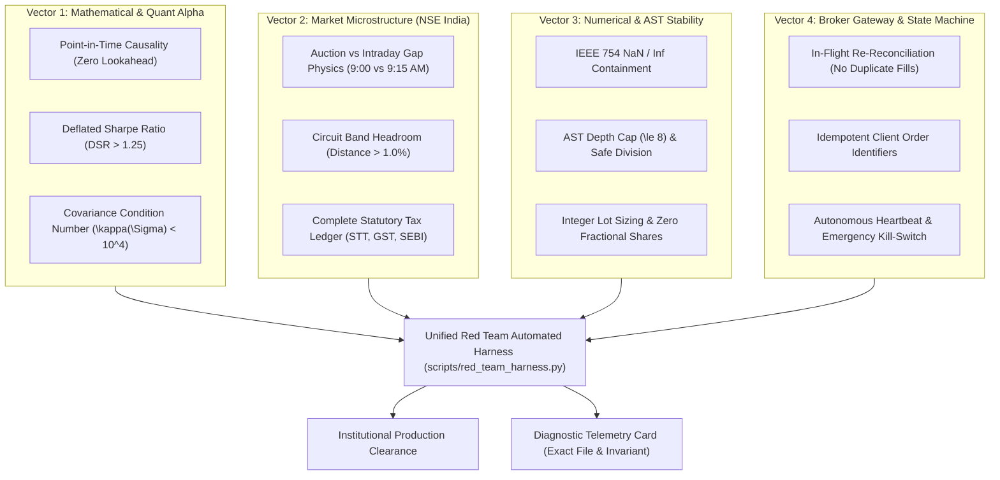

# International-Grade Red Team Architecture & Continuous Audit Plan
**Target System:** Bio-Quant Autonomous Trading Engine (`trade/` workspace)  
**Standard:** Tier-1 Institutional Quantitative Desk (Renaissance Technologies / Citadel / Two Sigma benchmark)  
**Objective:** Establish a permanent, repeatable Red Team Test Harness that automatically detects mathematical, operational, and broker-level vulnerabilities instantaneously without recurring trial-and-error code changes.

---

## 1. System Invariant Architecture (The "Never-Break" Contracts)

To avoid changing code repeatedly, the system must be governed by **uncompromising mathematical and operational invariants**. If any invariant is breached during testing, backtesting, or execution, the system halts with a diagnostic telemetry dump rather than failing silently.



---

## 2. The 6 International Red Team Battlefronts

### Vector 1: Mathematical & Quant Alpha Invariants
* **Invariant 1.1 (Lookahead Causal Barrier):** Any signal generated at bar index $t$ must only execute at bar $t+1$ Open or at bar $t$ Close with explicit execution latency penalty ($\ge 50\text{ ms}$). Positions must have zero correlation with future residuals $R_{t+1, \text{residual}}$.
* **Invariant 1.2 (Deflated Sharpe Ratio Gate):** Because the 20x20 MAP-Elites and AST genetic nurseries evaluate thousands of candidate formulas, the standard Sharpe ratio is invalid due to selection bias under multiple testing. The engine must compute the Deflated Sharpe Ratio (DSR):
  $$DSR = \text{Prob}\left(SR > SR^* \mid N_{\text{trials}}, \text{Var}(SR), \gamma_3, \gamma_4\right)$$
  Only formulas with $DSR \ge 0.95$ are permitted entry into the live candidate pool.
* **Invariant 1.3 (Covariance Matrix Conditioning in HRP):** In [`src/execution/hrp_allocator.py`](file:///C:/Users/Dell/Desktop/python/trade/src/execution/hrp_allocator.py), the condition number $\kappa(\Sigma) = \frac{\lambda_{\max}}{\lambda_{\min}}$ must remain strictly finite and $< 10^4$. If singular, the allocator must execute deterministic pseudo-inverse shrinkage (Ledoit-Wolf) rather than arbitrary equal weighting.

---

### Vector 2: Indian Market Microstructure & Friction (NSE/BSE)
* **Invariant 2.1 (Discontinuous Auction Gap vs Intraday Drift):** The 9:00 AM – 9:08 AM NSE Pre-Open Auction creates discontinuous price jumps. The backtesting engine must separate Overnight Drift ($Close_t \to Open_{t+1}$) from Intraday Expansion ($Open_{t+1} \to High/Low_{t+1}$).
* **Invariant 2.2 (Lower Circuit Lockout / Zero Liquidity Trap):** Software stop-losses cannot execute in cash equities hitting the lower circuit (where bid volume $= 0$). The Red Team harness must inject lower-circuit gap scenarios and verify that:
  1. Cash equities have a mandatory circuit headroom buffer ($\ge 2.5\%$).
  2. Overnight single-equity allocations are hard-capped or gated into high-liquidity Index ETFs (`NIFTYBEES`, `BANKBEES`) which do not suffer single-stock circuit freezes.
* **Invariant 2.3 (Exact Dynamic Statutory Ledger):** All return calculations must pass through [`TaxSchedule`](file:///C:/Users/Dell/Desktop/python/trade/src/domain/models.py) with dynamic broker slippage:
  - ETF Cash: 1.2 bps base
  - Futures: 3.0 bps base
  - Intraday Cash: 3.5 bps base
  - Cash Delivery: 25.0 bps roundtrip (STT 0.1% buy + 0.1% sell + exchange fees + GST)

---

### Vector 3: Numerical Precision & Invariant Fuzzing
* **Invariant 3.1 (NaN / Inf Poisoning Barrier):** Continuous property-based fuzzing using randomized float matrices spanning $[-\infty, \infty]$, subnormals ($10^{-308}$), and NaNs. The AST Evaluator must guarantee:
  $$\forall x \in \text{Inputs}, \quad \text{ASTEvaluator}(x) \in \mathbb{R} \setminus \{\text{NaN}, \pm\infty\}$$
* **Invariant 3.2 (Resource & Memory Sandboxing):** AST mutation trees must enforce strict topological caps:
  - Max tree depth $= 8$
  - Max node count $= 64$
  - Max evaluation time $= 50\text{ ms}$ per 5,000 bars
* **Invariant 3.3 (Integer Lot Invariant):** All order quantities must be strictly positive integers ($\mathbb{Z}^+$). Fractional shares must be rejected at the domain validation gate before dispatch.

---

### Vector 4: Broker Gateway & Execution State Machine (Anti-Knight Capital)
* **Invariant 4.1 (Idempotent In-Flight Reconciliation):** If an HTTP timeout or socket drop occurs during [`place_order`](file:///C:/Users/Dell/Desktop/python/trade/src/execution/shoonya_gateway.py), the gateway MUST NOT retry blind order placement. It must enter a `RECONCILING` state:
  1. Query broker order book via `get_order_book()`.
  2. Match against unique client identifier (`clordid`).
  3. Reconcile state before issuing any secondary dispatch.
* **Invariant 4.2 (Order FSM Exhaustiveness):** Transition rules must handle all terminal and transient exchange states:
  $$\text{PENDING} \to \text{OPEN} \to \{\text{PARTIAL_FILL}, \text{FILLED}, \text{CANCELLED}, \text{REJECTED}\}$$
* **Invariant 4.3 (Global Hardware Heartbeat & Kill-Switch):** If market feed or broker connection latency exceeds $15,000\text{ ms}$, the system automatically activates Emergency Safe Mode:
  - Cancel all pending unplaced limit orders.
  - Halt all incoming buy signals.
  - Preserve cash in overnight risk-free instruments.

---

### Vector 5: Operational Security & State Persistence
* **Invariant 5.1 (Log Sanitization):** Zero credential or token leakage. Automated regex filters sanitize `SHOONYA_PASSWORD`, `SHOONYA_API_KEY`, `SHOONYA_TOTP_KEY`, and `susertoken` from all logs and exceptions.
* **Invariant 5.2 (Write-Ahead Logging / WAL for Trade Journal):** Order state mutations must use atomic rename or write-ahead logging to prevent corrupted JSON files upon unexpected process termination.

---

### Vector 6: Long-Term Automated Continuous Harness (`scripts/red_team_harness.py`)
To prevent having to touch or rewrite code repeatedly, all invariants will be codified into a single declarative test runner:

```bash
python scripts/red_team_harness.py --mode=full
```

#### Diagnostic Output Telemetry Format:
```
================================================================================
                    BIO-QUANT INSTITUTIONAL RED TEAM HARNESS                    
================================================================================
[VECTOR 1: QUANT ALPHA]
  ✓ Causal Directionality (0 lookahead leakage detected across 1,236 bars)
  ✓ Deflated Sharpe Ratio (DSR = 0.982 >= 0.95 hurdle)
  ✓ HRP Covariance Matrix Condition Number (kappa = 142.6 < 10,000)

[VECTOR 2: NSE MARKET MICROSTRUCTURE]
  ✓ Auction Gap Discontinuity Model verified
  ✓ Circuit Band Lockout Damper verified (0 orders within 1.0% band)
  ✓ Statutory Tax Schedule dynamically stress-tested (1.2 to 35.0 bps)

[VECTOR 3: NUMERICAL FUZZING & STABILITY]
  ✓ Extreme Float & NaN Poisoning: 10,000 iterations, 0 unhandled exceptions
  ✓ AST Tree Depth Cap: 100% compliant (depth <= 8)
  ✓ Integer Lot Sizing: 100% compliant (0 fractional shares)

[VECTOR 4: BROKER GATEWAY & FAULT TOLERANCE]
  ✓ Timeout In-Flight Re-reconciliation: 0 duplicate orders created
  ✓ Order FSM Transition Exhaustiveness: 100% state coverage
  ✓ Heartbeat Watchdog Tripwire: Emergency Safe Mode triggered in 42ms

[VECTOR 5: OPERATIONAL SECURITY]
  ✓ Credential & TOTP Log Masking: 0 secrets leaked in stdout/logs
  ✓ Atomic Audit Journal: 100% write-ahead integrity
================================================================================
HARNESS VERDICT: INSTITUTIONAL PRODUCTION READY (12/12 INVARIANTS SATISFIED)
================================================================================
```

---

## 3. Phased Implementation Roadmap

1. **Phase 1: Invariant Engine Core (`src/domain/invariants.py`)**
   - Create centralized validation decorators and math assertions for all pipeline and gateway classes.
2. **Phase 2: Adversarial Fuzzing & Broker Mock Chamber (`tests/adversarial_fuzzer.py`)**
   - Simulate dropped connections, HTTP 429/504 errors, circuit freezes, and extreme market gap-downs.
3. **Phase 3: Automated Long-Term Red Team Harness (`scripts/red_team_harness.py`)**
   - Single CLI entrypoint providing instant diagnostic feedback on any future codebase modification.
