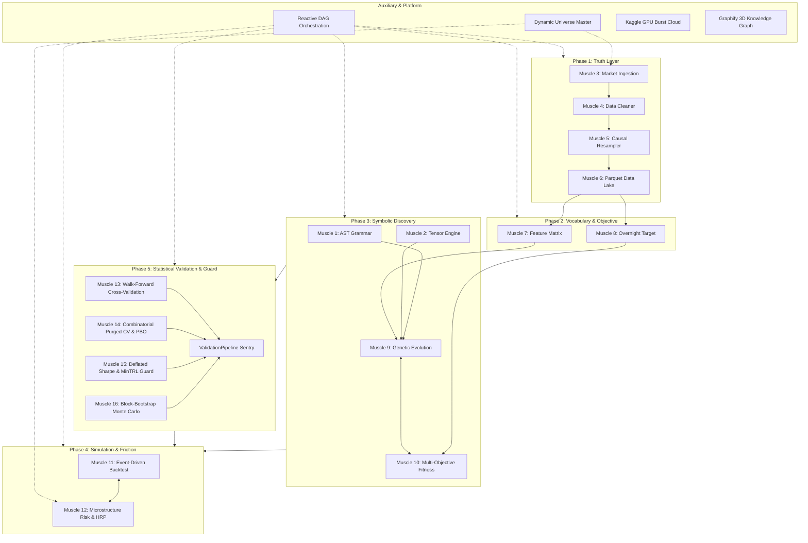

# RAVANA Sovereign Engine: File-to-Muscle Structural Manifest

This manifest documents every active file in the RAVANA repository, mapping each component directly to its sovereign muscle, architectural phase, functional responsibility, and test file.

---

## Architectural Muscle Matrix



---

## Phase 1: The Truth Layer (Data & Storage)

### Muscle 3: Market Data Ingestion & Session Gatekeeper
* **Root Directory:** [`ravana/data/ingestion/`](file:///c:/Users/Dell/Desktop/python/trade_clean/ravana/data/ingestion)
* **Core Responsibilities:** Multi-source market data ingestion, physical OHLCV candlestick invariant checks, split adjustments, and exchange trading session gatekeeping (NSE 09:15–15:30 IST, US EST, 24H UTC, Diwali Muhurat, Budget sessions).

| File | Type | Functional Role |
| :--- | :--- | :--- |
| [`config.py`](file:///c:/Users/Dell/Desktop/python/trade_clean/ravana/data/ingestion/config.py) | Config | Symbol ingestion profiles, market calendars, and source specs |
| [`session_gatekeeper.py`](file:///c:/Users/Dell/Desktop/python/trade_clean/ravana/data/ingestion/session_gatekeeper.py) | Logic | Session boundaries, special holiday schedules, and physical bar validations |
| [`loader.py`](file:///c:/Users/Dell/Desktop/python/trade_clean/ravana/data/ingestion/loader.py) | Engine | Ingestion worker supporting yfinance, CSV, and Parquet feeds |
| [`dataset.py`](file:///c:/Users/Dell/Desktop/python/trade_clean/ravana/data/ingestion/dataset.py) | Contract | Immutable `IngestedDataset` dataclass contract |
| [`__init__.py`](file:///c:/Users/Dell/Desktop/python/trade_clean/ravana/data/ingestion/__init__.py) | Module | Package export boundary |

* **Data Lake Store:** [`ravana/data/lake/m3_ingested/`](file:///c:/Users/Dell/Desktop/python/trade_clean/ravana/data/lake/m3_ingested) (`daily_1d/`, `intraday_5m/`, `m3_manifest.json`)
* **Dedicated Test File:** [`test_data_ingestion.py`](file:///c:/Users/Dell/Desktop/python/trade_clean/ravana/tests/test_data_ingestion.py)

---

### Muscle 4: Data Quality & Cleaning Engine
* **Root Directory:** [`ravana/data/cleaner/`](file:///c:/Users/Dell/Desktop/python/trade_clean/ravana/data/cleaner)
* **Core Responsibilities:** 75-bar intraday regularizer, forward filling with 0-volume synthetic bar tagging, robust MAD flash spike & aberrant wick filtering, and ETF-to-benchmark tracking spread aligner.

| File | Type | Functional Role |
| :--- | :--- | :--- |
| [`cleaner.py`](file:///c:/Users/Dell/Desktop/python/trade_clean/ravana/data/cleaner/cleaner.py) | Engine | Master cleaning orchestrator and quality audit synthesizer |
| [`grid_reindexer.py`](file:///c:/Users/Dell/Desktop/python/trade_clean/ravana/data/cleaner/grid_reindexer.py) | Logic | Strict 5m time grid enforcer and causal synthetic bar synthesizer |
| [`spike_filter.py`](file:///c:/Users/Dell/Desktop/python/trade_clean/ravana/data/cleaner/spike_filter.py) | Logic | Robust Median Absolute Deviation (MAD) rolling outlier filter |
| [`spread_aligner.py`](file:///c:/Users/Dell/Desktop/python/trade_clean/ravana/data/cleaner/spread_aligner.py) | Analytics | ETF tracking error, basis points spread, and discount/premium calculator |
| [`config.py`](file:///c:/Users/Dell/Desktop/python/trade_clean/ravana/data/cleaner/config.py) | Config | Cleaning thresholds, MAD window lengths, and spike bounds |
| [`dataset.py`](file:///c:/Users/Dell/Desktop/python/trade_clean/ravana/data/cleaner/dataset.py) | Contract | Immutable `CleanedDataset` contract & `QualityReport` schema |
| [`__init__.py`](file:///c:/Users/Dell/Desktop/python/trade_clean/ravana/data/cleaner/__init__.py) | Module | Package export boundary |

* **Data Lake Store:** [`ravana/data/lake/m4_cleaned/`](file:///c:/Users/Dell/Desktop/python/trade_clean/ravana/data/lake/m4_cleaned) (`daily_1d/`, `intraday_5m/`, `m4_quality_reports.json`)
* **Dedicated Test File:** [`test_data_cleaner.py`](file:///c:/Users/Dell/Desktop/python/trade_clean/ravana/tests/test_data_cleaner.py)

---

### Muscle 5: Causal Multi-Timeframe Resampler
* **Root Directory:** [`ravana/data/resampler/`](file:///c:/Users/Dell/Desktop/python/trade_clean/ravana/data/resampler)
* **Core Responsibilities:** Strictly causal right-closed multi-timeframe aggregation (`5m -> 15m, 30m, 1h` and `1d -> 1wk, 1mo`) with zero session boundary bleeding and turnover-weighted VWAP.

| File | Type | Functional Role |
| :--- | :--- | :--- |
| [`resampler.py`](file:///c:/Users/Dell/Desktop/python/trade_clean/ravana/data/resampler/resampler.py) | Engine | Causal bar aggregator with right-labeling and session isolation |
| [`vwap.py`](file:///c:/Users/Dell/Desktop/python/trade_clean/ravana/data/resampler/vwap.py) | Logic | Exact turnover-weighted Volume Weighted Average Price calculator |
| [`config.py`](file:///c:/Users/Dell/Desktop/python/trade_clean/ravana/data/resampler/config.py) | Config | Target timeframes, right-closed rules, and incomplete bar policies |
| [`dataset.py`](file:///c:/Users/Dell/Desktop/python/trade_clean/ravana/data/resampler/dataset.py) | Contract | Immutable `ResampledDataset` contract schema |
| [`__init__.py`](file:///c:/Users/Dell/Desktop/python/trade_clean/ravana/data/resampler/__init__.py) | Module | Package export boundary |

* **Data Lake Store:** [`ravana/data/lake/m5_resampled/`](file:///c:/Users/Dell/Desktop/python/trade_clean/ravana/data/lake/m5_resampled) (`intraday_15m/`, `intraday_30m/`, `intraday_1h/`, `macro_1wk/`, `macro_1mo/`)
* **Dedicated Test File:** [`test_data_resampler.py`](file:///c:/Users/Dell/Desktop/python/trade_clean/ravana/tests/test_data_resampler.py)

---

### Muscle 6: Sovereign Columnar Parquet Data Lake
* **Root Directory:** [`ravana/data/storage/`](file:///c:/Users/Dell/Desktop/python/trade_clean/ravana/data/storage)
* **Core Responsibilities:** High-performance columnar storage, partition layout management across Bronze/Silver/Gold tiers, atomic upsert engine with snapshot protection, and schema enforcement.

| File | Type | Functional Role |
| :--- | :--- | :--- |
| [`lake_manager.py`](file:///c:/Users/Dell/Desktop/python/trade_clean/ravana/data/storage/lake_manager.py) | Engine | Columnar lakehouse coordinator, catalog auditor, and projection reader |
| [`upsert.py`](file:///c:/Users/Dell/Desktop/python/trade_clean/ravana/data/storage/upsert.py) | Logic | Atomic temp-file swap incremental upsert with duplicate index deduplication |
| [`validator.py`](file:///c:/Users/Dell/Desktop/python/trade_clean/ravana/data/storage/validator.py) | Logic | Parquet schema verifier, NaN/Inf detector, and integrity validator |
| [`config.py`](file:///c:/Users/Dell/Desktop/python/trade_clean/ravana/data/storage/config.py) | Config | Lake folder paths, snappy compression levels, and partition patterns |
| [`__init__.py`](file:///c:/Users/Dell/Desktop/python/trade_clean/ravana/data/storage/__init__.py) | Module | Package export boundary |

* **Data Lake Store:** [`ravana/data/lake/`](file:///c:/Users/Dell/Desktop/python/trade_clean/ravana/data/lake) (Central Parquet repository)
* **Dedicated Test Files:**
  - [`test_data_storage.py`](file:///c:/Users/Dell/Desktop/python/trade_clean/ravana/tests/test_data_storage.py)
  - [`test_lake_diff.py`](file:///c:/Users/Dell/Desktop/python/trade_clean/ravana/tests/test_lake_diff.py)

---

## Phase 2: Vocabulary & Objective Layer

### Muscle 7: Market Vocabulary Feature Matrix Engine
* **Root Directory:** [`ravana/features/`](file:///c:/Users/Dell/Desktop/python/trade_clean/ravana/features)
* **Core Responsibilities:** 21 standardized stationary feature transformations, ADF stationarity testing, Ornstein-Uhlenbeck (OU) half-life calculation, and $[T \times K]$ / $[B, T, K]$ tensor materialization.

| File | Type | Functional Role |
| :--- | :--- | :--- |
| [`matrix_engine.py`](file:///c:/Users/Dell/Desktop/python/trade_clean/ravana/features/matrix_engine.py) | Engine | Feature synthesizer producing zero-lookahead 2D matrices and 3D PyTorch tensors |
| [`stationarity.py`](file:///c:/Users/Dell/Desktop/python/trade_clean/ravana/features/stationarity.py) | Math | Trace-scaled Augmented Dickey-Fuller (ADF) test & OU mean-reversion half-life |
| [`technical_primitives.py`](file:///c:/Users/Dell/Desktop/python/trade_clean/ravana/features/technical_primitives.py) | Logic | Pure vectorized formulas (Garman-Klass, Parkinson, VWAP drift, RSI, ATR) |
| [`config.py`](file:///c:/Users/Dell/Desktop/python/trade_clean/ravana/features/config.py) | Config | Lookback windows (5, 14, 20, 60 bars) and normalization bounds |
| [`__init__.py`](file:///c:/Users/Dell/Desktop/python/trade_clean/ravana/features/__init__.py) | Module | Package export boundary |

* **Data Lake Store:** [`ravana/data/lake/m7_features/`](file:///c:/Users/Dell/Desktop/python/trade_clean/ravana/data/lake/m7_features)
* **Dedicated Test File:** [`test_features_matrix.py`](file:///c:/Users/Dell/Desktop/python/trade_clean/ravana/tests/test_features_matrix.py)

---

### Muscle 8: Overnight Target & Objective Builder
* **Root Directory:** [`ravana/targets/`](file:///c:/Users/Dell/Desktop/python/trade_clean/ravana/targets)
* **Core Responsibilities:** Forward overnight economic target construction ($t \text{ [15:24 IST]} \to t+1 \text{ [09:16 IST]}$), capital threshold gates (₹2,00,000+), and deduction of statutory cash delivery drag (2.85 bps + ₹17 CDSL fee).

| File | Type | Functional Role |
| :--- | :--- | :--- |
| [`builder.py`](file:///c:/Users/Dell/Desktop/python/trade_clean/ravana/targets/builder.py) | Engine | Forward target generator, continuous returns, and sign-based binary targets |
| [`costs.py`](file:///c:/Users/Dell/Desktop/python/trade_clean/ravana/targets/costs.py) | Logic | Indian statutory cash friction schedule and delivery drag cost models |
| [`config.py`](file:///c:/Users/Dell/Desktop/python/trade_clean/ravana/targets/config.py) | Config | Holding horizons, capital gate thresholds, and hurdle rates |
| [`__init__.py`](file:///c:/Users/Dell/Desktop/python/trade_clean/ravana/targets/__init__.py) | Module | Package export boundary |

* **Data Lake Store:** [`ravana/data/lake/m8_targets/`](file:///c:/Users/Dell/Desktop/python/trade_clean/ravana/data/lake/m8_targets)
* **Dedicated Test File:** [`test_targets_builder.py`](file:///c:/Users/Dell/Desktop/python/trade_clean/ravana/tests/test_targets_builder.py)

---

## Phase 3: Symbolic Discovery & Evolution

### Muscle 1: Symbolic Formula AST Grammar & Primitives
* **Root Directory:** [`ravana/domain/`](file:///c:/Users/Dell/Desktop/python/trade_clean/ravana/domain)
* **Core Responsibilities:** Strongly-typed Abstract Syntax Tree (AST) grammar, 26 institutional primitives, safe protected math (`SAFE_DIV`, `SAFE_LOG`, `TANH`), algebraic simplification, and prefix/infix serialization.

| File | Type | Functional Role |
| :--- | :--- | :--- |
| [`formula_ast.py`](file:///c:/Users/Dell/Desktop/python/trade_clean/ravana/domain/formula_ast.py) | Core | AST Node hierarchies (`BinaryOp`, `UnaryOp`, `TsOp`, `FeatureNode`, `ConstantNode`) |
| [`formula_parser.py`](file:///c:/Users/Dell/Desktop/python/trade_clean/ravana/domain/formula_parser.py) | Parser | Infix/prefix string parser reconstructing strongly-typed AST trees |
| [`genetics.py`](file:///c:/Users/Dell/Desktop/python/trade_clean/ravana/domain/genetics.py) | Genetics | Type-safe dimensional crossover, subtree mutation, and point mutation |
| [`__init__.py`](file:///c:/Users/Dell/Desktop/python/trade_clean/ravana/domain/__init__.py) | Module | Package export boundary |

* **Dedicated Test Files:**
  - [`test_formula_ast.py`](file:///c:/Users/Dell/Desktop/python/trade_clean/ravana/tests/test_formula_ast.py)
  - [`benchmark_muscle1_intraday_5m.py`](file:///c:/Users/Dell/Desktop/python/trade_clean/ravana/tests/benchmark_muscle1_intraday_5m.py)
  - [`benchmark_muscle1_real_work.py`](file:///c:/Users/Dell/Desktop/python/trade_clean/ravana/tests/benchmark_muscle1_real_work.py)

---

### Muscle 2: PyTorch Vectorized Tensor Engine
* **Root Directory:** [`ravana/compute/`](file:///c:/Users/Dell/Desktop/python/trade_clean/ravana/compute)
* **Core Responsibilities:** High-throughput PyTorch GPU formula evaluator (>1,300 formulas/sec on Tesla T4), rolling 1D FIR convolution kernels, chunked batching, and dynamic hardware dispatcher.

| File | Type | Functional Role |
| :--- | :--- | :--- |
| [`tensor_evaluator.py`](file:///c:/Users/Dell/Desktop/python/trade_clean/ravana/compute/tensor_evaluator.py) | Engine | Vectorized AST-to-PyTorch tensor compiler and batch evaluator |
| [`primitives.py`](file:///c:/Users/Dell/Desktop/python/trade_clean/ravana/compute/primitives.py) | Math | PyTorch implementations of rolling time-series operators and safe functions |
| [`dispatcher.py`](file:///c:/Users/Dell/Desktop/python/trade_clean/ravana/compute/dispatcher.py) | Dispatcher | Auto-hardware routing (NumPy CPU fallback $\leftrightarrow$ CUDA GPU batching) |
| [`kaggle_runner.py`](file:///c:/Users/Dell/Desktop/python/trade_clean/ravana/compute/kaggle_runner.py) | Cloud | Headless Kaggle API burst compute submission, polling, and results downloader |
| [`__init__.py`](file:///c:/Users/Dell/Desktop/python/trade_clean/ravana/compute/__init__.py) | Module | Package export boundary |

* **Dedicated Test Files:**
  - [`test_tensor_evaluator.py`](file:///c:/Users/Dell/Desktop/python/trade_clean/ravana/tests/test_tensor_evaluator.py)
  - [`test_compute_dispatcher.py`](file:///c:/Users/Dell/Desktop/python/trade_clean/ravana/tests/test_compute_dispatcher.py)
  - [`test_kaggle_runner.py`](file:///c:/Users/Dell/Desktop/python/trade_clean/ravana/tests/test_kaggle_runner.py)
  - [`test_muscle1_muscle2_integration.py`](file:///c:/Users/Dell/Desktop/python/trade_clean/ravana/tests/test_muscle1_muscle2_integration.py)
  - [`benchmark_muscle2_speed.py`](file:///c:/Users/Dell/Desktop/python/trade_clean/ravana/tests/benchmark_muscle2_speed.py)

---

### Muscle 9: Genetic Alpha Evolution & Search Engine
* **Root Directory:** [`ravana/evolution/`](file:///c:/Users/Dell/Desktop/python/trade_clean/ravana/evolution)
* **Core Responsibilities:** Population initialization, tournament selection, Challenger-Champion v1.1 protocol, parsimony complexity penalization, and Idea Graveyard ledger preventing duplicate evaluations.

| File | Type | Functional Role |
| :--- | :--- | :--- |
| [`engine.py`](file:///c:/Users/Dell/Desktop/python/trade_clean/ravana/evolution/engine.py) | Engine | Master genetic algorithm orchestrator running generational evolution cycles |
| [`graveyard.py`](file:///c:/Users/Dell/Desktop/python/trade_clean/ravana/evolution/graveyard.py) | Memory | Persistent hash ledger of dead/degenerate formulas to prevent wasted compute |
| [`config.py`](file:///c:/Users/Dell/Desktop/python/trade_clean/ravana/evolution/config.py) | Config | Population sizing, generations, elitism counts, mutation/crossover rates |
| [`__init__.py`](file:///c:/Users/Dell/Desktop/python/trade_clean/ravana/evolution/__init__.py) | Module | Package export boundary |

* **Discovered Alphas Store:** [`ravana/data/lake/m9_alphas/kaggle_results/`](file:///c:/Users/Dell/Desktop/python/trade_clean/ravana/data/lake/m9_alphas/kaggle_results) (`champion_alpha.json`, `pareto_frontier.json`, `evolution_summary.json`)
* **Dedicated Test File:** [`test_genetic_evolution.py`](file:///c:/Users/Dell/Desktop/python/trade_clean/ravana/tests/test_genetic_evolution.py)

---

### Muscle 10: Multi-Objective Alpha Fitness Engine
* **Root Directory:** [`ravana/fitness/`](file:///c:/Users/Dell/Desktop/python/trade_clean/ravana/fitness)
* **Core Responsibilities:** Multi-metric alpha scoring, Information Coefficient (IC), Rank IC, Deflated Sharpe Ratio (DSR), Benjamini-Hochberg False Discovery Rate (FDR), turnover penalties, and Pareto frontier extraction.

| File | Type | Functional Role |
| :--- | :--- | :--- |
| [`engine.py`](file:///c:/Users/Dell/Desktop/python/trade_clean/ravana/fitness/engine.py) | Engine | Fitness scoring coordinator combining statistical quality and parsimony penalties |
| [`metrics.py`](file:///c:/Users/Dell/Desktop/python/trade_clean/ravana/fitness/metrics.py) | Math | Fast vectorized computation of IC, Rank IC, Turnover, and Max Drawdown |
| [`deflated_sharpe.py`](file:///c:/Users/Dell/Desktop/python/trade_clean/ravana/fitness/deflated_sharpe.py) | Math | Marcos López de Prado's Deflated Sharpe Ratio (DSR) implementation |
| [`fdr.py`](file:///c:/Users/Dell/Desktop/python/trade_clean/ravana/fitness/fdr.py) | Stats | Benjamini-Hochberg procedure controlling family-wise error rates |
| [`pareto.py`](file:///c:/Users/Dell/Desktop/python/trade_clean/ravana/fitness/pareto.py) | Multi-Obj | Non-dominated sorting extracting the true multi-objective Pareto frontier |
| [`config.py`](file:///c:/Users/Dell/Desktop/python/trade_clean/ravana/fitness/config.py) | Config | Minimum IC thresholds, parsimony penalties ($\lambda$), and turnover limits |
| [`__init__.py`](file:///c:/Users/Dell/Desktop/python/trade_clean/ravana/fitness/__init__.py) | Module | Package export boundary |

* **Dedicated Test File:** [`test_fitness_engine.py`](file:///c:/Users/Dell/Desktop/python/trade_clean/ravana/tests/test_fitness_engine.py)

---

## Phase 4: Simulation & Realistic Friction

### Muscle 11: Event-Driven Vectorized Backtester & Statutory Ledger
* **Root Directory:** [`ravana/backtest/`](file:///c:/Users/Dell/Desktop/python/trade_clean/ravana/backtest)
* **Core Responsibilities:** Non-anticipating $t \to t+1$ causal fill simulation, FIFO lot matching, Almgren-Chriss square-root impact slippage, 5% volume participation cap, and exhaustive line-item Indian statutory friction ledger.

| File | Type | Functional Role |
| :--- | :--- | :--- |
| [`engine.py`](file:///c:/Users/Dell/Desktop/python/trade_clean/ravana/backtest/engine.py) | Engine | Bar-by-bar causal simulator, cash ledger, FIFO lots, and institutional metrics |
| [`friction.py`](file:///c:/Users/Dell/Desktop/python/trade_clean/ravana/backtest/friction.py) | Tax & Fees | Exact Indian statutory schedule (STT delivery/intraday, DP charges, stamp duty, GST) |
| [`orders.py`](file:///c:/Users/Dell/Desktop/python/trade_clean/ravana/backtest/orders.py) | Schema | Strongly typed `Order`, `Fill`, `FifoLot`, and `RoundTripTrade` records |
| [`slippage.py`](file:///c:/Users/Dell/Desktop/python/trade_clean/ravana/backtest/slippage.py) | Math | Almgren-Chriss square-root market impact slippage calculator |
| [`config.py`](file:///c:/Users/Dell/Desktop/python/trade_clean/ravana/backtest/config.py) | Config | Capital configuration, brokerage caps (₹20), and execution regimes |
| [`__init__.py`](file:///c:/Users/Dell/Desktop/python/trade_clean/ravana/backtest/__init__.py) | Module | Package export boundary |

* **Dedicated Test File:** [`test_backtest_engine.py`](file:///c:/Users/Dell/Desktop/python/trade_clean/ravana/tests/test_backtest_engine.py)

---

### Muscle 12: Microstructure Portfolio & Risk Allocation Engine
* **Root Directory:** [`ravana/risk/`](file:///c:/Users/Dell/Desktop/python/trade_clean/ravana/risk)
* **Core Responsibilities:** Hierarchical Risk Parity (HRP) with Ledoit-Wolf shrinkage, Marcenko-Pastur RMT covariance denoising, ₹2,00,000 capital gate, water-filling cap redistribution, and 150 bps hysteresis drawdown circuit breakers.

| File | Type | Functional Role |
| :--- | :--- | :--- |
| [`engine.py`](file:///c:/Users/Dell/Desktop/python/trade_clean/ravana/risk/engine.py) | Engine | Master portfolio allocation coordinator, whole-share order sizing, NAV tracking |
| [`hrp.py`](file:///c:/Users/Dell/Desktop/python/trade_clean/ravana/risk/hrp.py) | Math | Quasi-diagonalization, hierarchical tree clustering, RMT spectral denoising |
| [`gatekeeper.py`](file:///c:/Users/Dell/Desktop/python/trade_clean/ravana/risk/gatekeeper.py) | Governance | Capital threshold filter, statutory hurdle checks, and hysteresis drawdown sentry |
| [`config.py`](file:///c:/Users/Dell/Desktop/python/trade_clean/ravana/risk/config.py) | Config | Target volatility, drawdown tiers (4%/8%), and minimum trade notionals |
| [`__init__.py`](file:///c:/Users/Dell/Desktop/python/trade_clean/ravana/risk/__init__.py) | Module | Package export boundary |

* **Dedicated Test File:** [`test_risk_engine.py`](file:///c:/Users/Dell/Desktop/python/trade_clean/ravana/tests/test_risk_engine.py)

---

## Phase 5: Statistical Validation & Anti-Overfitting Sentry

### Muscle 13: Causal Walk-Forward Cross-Validation
* **Root Directory:** [`ravana/validation/`](file:///c:/Users/Dell/Desktop/python/trade_clean/ravana/validation)
* **Core Responsibilities:** Anchored and rolling time-series out-of-sample splits, dynamic holding horizon embargo/purging, 60-bar continuous causal rolling warmup, and frozen in-sample $(\mu_{\text{train}}, \sigma_{\text{train}})$ standardization via `compute_oos_strategy_returns`.

| File | Type | Functional Role |
| :--- | :--- | :--- |
| [`walk_forward.py`](file:///c:/Users/Dell/Desktop/python/trade_clean/ravana/validation/walk_forward.py) | Engine | Time-series fold generator, causal rolling AST warmup, and OOS equity aggregator |

### Muscle 14: Combinatorial Purged Cross-Validation & PBO
* **Root Directory:** [`ravana/validation/`](file:///c:/Users/Dell/Desktop/python/trade_clean/ravana/validation)
* **Core Responsibilities:** $C(N, k)$ combinatorial train/test group splitting, forward/backward purging, Probability of Backtest Overfitting (PBO), and rank-degradation distribution analysis.

| File | Type | Functional Role |
| :--- | :--- | :--- |
| [`cpcv.py`](file:///c:/Users/Dell/Desktop/python/trade_clean/ravana/validation/cpcv.py) | Engine | Combinatorial fold partitioning, purged/embargoed test slices, and population PBO evaluator |

### Muscle 15: Deflated Sharpe & MinTRL Overfitting Guard
* **Root Directory:** [`ravana/validation/`](file:///c:/Users/Dell/Desktop/python/trade_clean/ravana/validation)
* **Core Responsibilities:** Institutional Bailey & López de Prado (2014) DSR certification, empirical population variance tracking, Minimum Track Record Length (MinTRL) enforcement, and hard hurdle gatekeeping.

| File | Type | Functional Role |
| :--- | :--- | :--- |
| [`dsr_guard.py`](file:///c:/Users/Dell/Desktop/python/trade_clean/ravana/validation/dsr_guard.py) | Math | Exact DSR test statistic, asymptotic MinTRL threshold calculator, and pass/fail certifier |

### Muscle 16: Circular Block-Bootstrap Monte Carlo Stress Testing
* **Root Directory:** [`ravana/validation/`](file:///c:/Users/Dell/Desktop/python/trade_clean/ravana/validation)
* **Core Responsibilities:** Circular block bootstrap preserving intraday autocorrelation, annualized CAGR/volatility distribution sampling, 4% caution and 8% ruin probability stress bounds.

| File | Type | Functional Role |
| :--- | :--- | :--- |
| [`monte_carlo.py`](file:///c:/Users/Dell/Desktop/python/trade_clean/ravana/validation/monte_carlo.py) | Simulation | Politis-Romano circular block resampling, VaR/CVaR tails, and ruin probability calculator |

### Master Validation Pipeline & Schema Contracts
* **Root Directory:** [`ravana/validation/`](file:///c:/Users/Dell/Desktop/python/trade_clean/ravana/validation)
* **Core Responsibilities:** Orchestrates M13 $\to$ M14 $\to$ M15 $\to$ M16 into a single unified `ValidationCertificate` with zero-leakage gatekeeping.

| File | Type | Functional Role |
| :--- | :--- | :--- |
| [`pipeline.py`](file:///c:/Users/Dell/Desktop/python/trade_clean/ravana/validation/pipeline.py) | Coordinator | Master end-to-end certification pipeline generating unified audit certificates |
| [`config.py`](file:///c:/Users/Dell/Desktop/python/trade_clean/ravana/validation/config.py) | Config | Strongly-typed dataclass contracts for all folds, results, thresholds, and reports |
| [`__init__.py`](file:///c:/Users/Dell/Desktop/python/trade_clean/ravana/validation/__init__.py) | Module | Package export boundary |

* **Data Lake Store:** [`ravana/data/lake/m13_validation/`](file:///c:/Users/Dell/Desktop/python/trade_clean/ravana/data/lake/m13_validation) (`validation_certificates/`)
* **Dedicated Test File:** [`test_validation_engine.py`](file:///c:/Users/Dell/Desktop/python/trade_clean/ravana/tests/test_validation_engine.py)

---

## Auxiliary Subsystems & Infrastructure

### Dynamic Universe Selection & Security Master (Muscle 1 Auxiliary)
* **Root Directory:** [`ravana/data/universe/`](file:///c:/Users/Dell/Desktop/python/trade_clean/ravana/data/universe)
* **Core Responsibilities:** Point-in-time Security Master, asset catalog metadata, composable boolean query DSL (`BasketUniverse`, `TagUniverse`, union `|`, intersection `&`).

| File | Type | Functional Role |
| :--- | :--- | :--- |
| [`models.py`](file:///c:/Users/Dell/Desktop/python/trade_clean/ravana/data/universe/models.py) | Schema | Security metadata, asset classes (`ETF`, `EQUITY_STOCK`), and lot models |
| [`registry.py`](file:///c:/Users/Dell/Desktop/python/trade_clean/ravana/data/universe/registry.py) | Master | Point-in-time catalog query registry loaded from YAML |
| [`selector.py`](file:///c:/Users/Dell/Desktop/python/trade_clean/ravana/data/universe/selector.py) | DSL | Composable declarative selection DSL and runtime query parser |
| [`__init__.py`](file:///c:/Users/Dell/Desktop/python/trade_clean/ravana/data/universe/__init__.py) | Module | Package export boundary |
| [`asset_catalog.yaml`](file:///c:/Users/Dell/Desktop/python/trade_clean/ravana/config/asset_catalog.yaml) | Config | Declarative master catalog of Indian ETFs, benchmark indices, and global drivers |

* **Dedicated Test File:** [`test_universe_registry.py`](file:///c:/Users/Dell/Desktop/python/trade_clean/ravana/tests/test_universe_registry.py)

---

### Pipeline Orchestration & End-to-End Execution
* **Root Directory:** [`ravana/pipeline/`](file:///c:/Users/Dell/Desktop/python/trade_clean/ravana/pipeline) & [`ravana/data/`](file:///c:/Users/Dell/Desktop/python/trade_clean/ravana/data)

| File | Type | Functional Role |
| :--- | :--- | :--- |
| [`dag.py`](file:///c:/Users/Dell/Desktop/python/trade_clean/ravana/pipeline/dag.py) | Pipeline | Reactive DAG tying Ingestion $\to$ Cleaning $\to$ Resampling $\to$ Storage $\to$ Features $\to$ Target |
| [`pipeline_runner.py`](file:///c:/Users/Dell/Desktop/python/trade_clean/ravana/data/pipeline_runner.py) | Runner | CLI entrypoint running automated batch data processing across symbols |
| [`pipeline_helpers.py`](file:///c:/Users/Dell/Desktop/python/trade_clean/ravana/data/pipeline_helpers.py) | Helpers | Common lakehouse loading, partition scanning, and dataframe conversion utilities |

---

### Cloud Burst Compute & Offline Bundlers
* **Root Directory:** [`scratch/`](file:///c:/Users/Dell/Desktop/python/trade_clean/scratch) & [`ravana/notebooks/`](file:///c:/Users/Dell/Desktop/python/trade_clean/ravana/notebooks)

| File | Type | Functional Role |
| :--- | :--- | :--- |
| [`build_kaggle_payload.py`](file:///c:/Users/Dell/Desktop/python/trade_clean/scratch/build_kaggle_payload.py) | Builder | Automated compressor packing features/targets into an offline Kaggle script |
| [`burst_run.py`](file:///c:/Users/Dell/Desktop/python/trade_clean/scratch/kaggle_bundle/burst_run.py) | Script | Self-contained GPU execution script running 7,500 evaluations on Tesla T4 |
| [`kernel-metadata.json`](file:///c:/Users/Dell/Desktop/python/trade_clean/scratch/kaggle_bundle/kernel-metadata.json) | Config | Kaggle API kernel specification and runtime flags |
| [`ravana_kaggle_runner.ipynb`](file:///c:/Users/Dell/Desktop/python/trade_clean/ravana/notebooks/ravana_kaggle_runner.ipynb) | Notebook | Interactive Jupyter runner for exploratory GPU evaluation |

---

### Knowledge Graph & Visual Architecture Intelligence
* **Root Directory:** [`ravana/graphify-out/`](file:///c:/Users/Dell/Desktop/python/trade_clean/ravana/graphify-out)

| File | Type | Functional Role |
| :--- | :--- | :--- |
| [`graph_3d.html`](file:///c:/Users/Dell/Desktop/python/trade_clean/ravana/graphify-out/graph_3d.html) | UI | Interactive WebGL 3D architecture knowledge graph (1,580 nodes, 3,025 links) |
| [`graph.html`](file:///c:/Users/Dell/Desktop/python/trade_clean/ravana/graphify-out/graph.html) | UI | 2D interactive Cytoscape network graph |
| [`graph.json`](file:///c:/Users/Dell/Desktop/python/trade_clean/ravana/graphify-out/graph.json) | Data | Graphify JSON topological graph specification |
| [`GRAPH_REPORT.md`](file:///c:/Users/Dell/Desktop/python/trade_clean/ravana/graphify-out/GRAPH_REPORT.md) | Doc | Comprehensive cluster analysis, god-node detection, and dependency audit |
| [`generate_3d_graph.py`](file:///c:/Users/Dell/Desktop/python/trade_clean/scratch/generate_3d_graph.py) | Generator | Three.js visualizer generator embedding the entire AST codebase in 3D |

---

## Test Suite Summary

Every muscle is verified by dedicated unit tests in [`ravana/tests/`](file:///c:/Users/Dell/Desktop/python/trade_clean/ravana/tests).
Currently **140/140 tests pass** with zero failures:

```
[Muscle 1]   test_formula_ast.py                     --> 18 tests OK
[Muscle 2]   test_tensor_evaluator.py                --> 15 tests OK
[Muscle 2]   test_compute_dispatcher.py             -->  6 tests OK
[Muscle 2]   test_kaggle_runner.py                  -->  5 tests OK
[Muscle 1+2] test_muscle1_muscle2_integration.py    -->  4 tests OK
[Muscle 3]   test_data_ingestion.py                  --> 14 tests OK
[Muscle 4]   test_data_cleaner.py                    --> 12 tests OK
[Muscle 5]   test_data_resampler.py                  --> 12 tests OK
[Muscle 6]   test_data_storage.py                    --> 10 tests OK
[Muscle 6]   test_lake_diff.py                       -->  4 tests OK
[Muscle 7]   test_features_matrix.py                 -->  8 tests OK
[Muscle 8]   test_targets_builder.py                 -->  8 tests OK
[Muscle 9]   test_genetic_evolution.py               -->  6 tests OK
[Muscle 10]  test_fitness_engine.py                  -->  6 tests OK
[Muscle 11]  test_backtest_engine.py                 -->  7 tests OK
[Muscle 12]  test_risk_engine.py                     --> 11 tests OK
[Phase 5]    test_validation_engine.py               -->  7 tests OK
[Audit M1-12] test_audit_remediation.py              --> 10 tests OK
[Universe]   test_universe_registry.py               -->  5 tests OK
--------------------------------------------------------------------------
TOTAL: 150 TESTS (100% GREEN)
```
