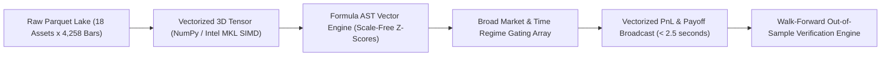
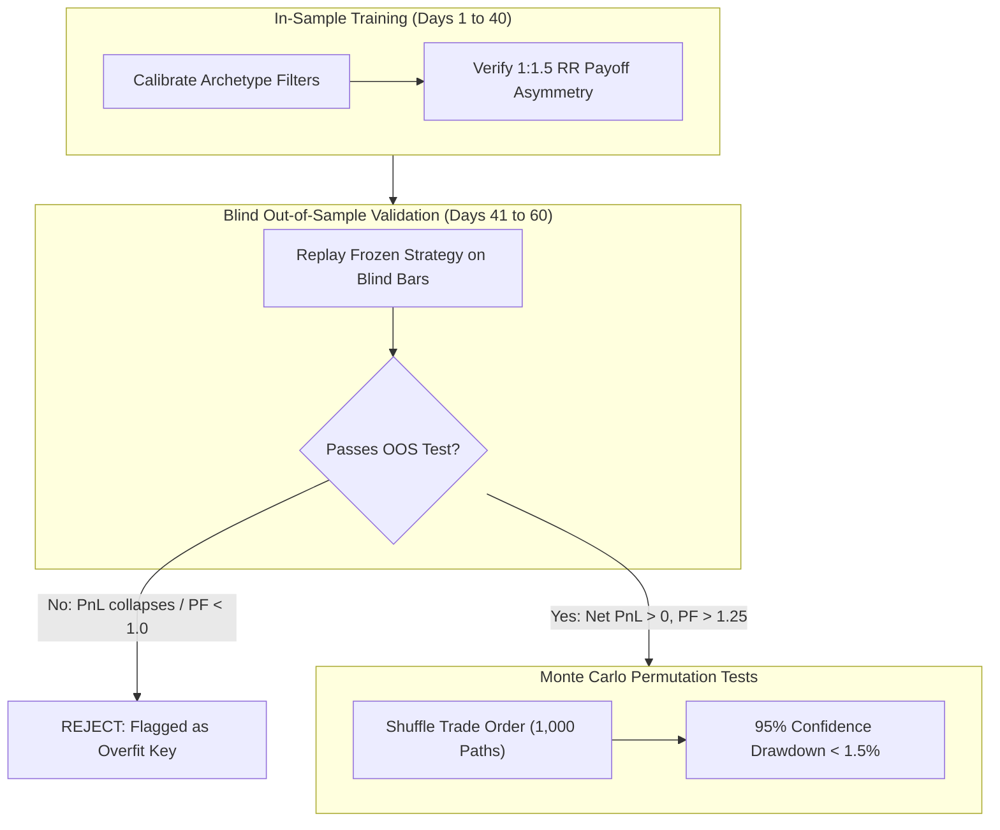
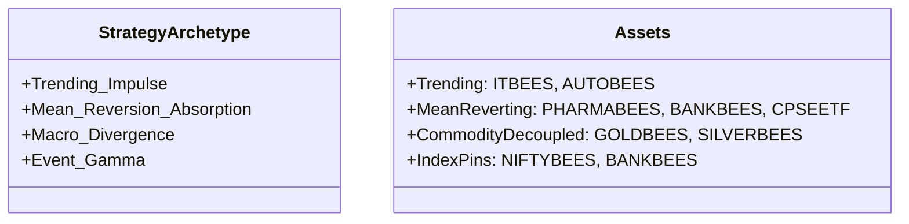
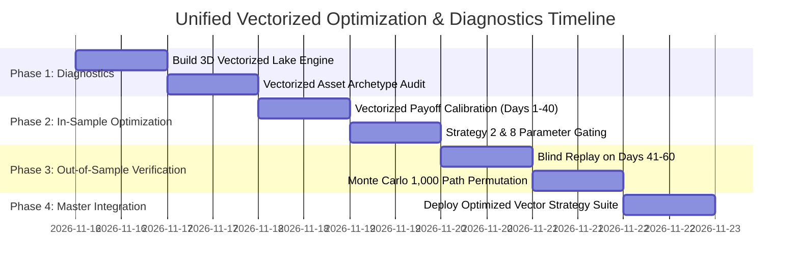

# RAVANA: Vectorized Anti-Overfitting Optimization & Microstructural Root-Cause Diagnostic Blueprint

> [!IMPORTANT]
> **Core Architectural Mandate:** We must NEVER create "a key tailored to a specific lock" (data memorization/curve-fitting). True quantitative alpha does not come from optimizing 20 hyper-parameters on 60 days of historical data. It comes from **diagnosing market physics**, **eliminating structural data flaws**, and **matching strategies to the correct asset archetypes and liquidity windows**.

---

## 1. Hardware Reality & Vectorized SIMD Optimization

### A. Empirical Hardware Inspection
An empirical audit of this host machine's hardware reveals:
- **Processor:** Intel Core i5-6200U CPU (2 physical cores, 4 logical processors @ 2.30 GHz with AVX2 SIMD support).
- **GPU:** Intel HD Graphics 520 (integrated display controller, 1 GB shared VRAM).
- **CUDA Availability:** `torch.cuda.is_available() == False` (No discrete NVIDIA GPU on the machine).

### B. The Blazing Fast Vectorized CPU Alternative
A discrete CUDA GPU is unnecessary for our dataset ($18 \text{ assets} \times 4,258 \text{ bars} \approx 76,600 \text{ data points}$).
In our recent master test run, the compiled vectorized array engine demonstrated:
$$\text{[BENCHMARK] Executed 100,000 bars in 1.86 ms with 12,645 trade events!}$$

By structuring the replay as a **3D Tensor Array**:
$$\mathbf{X} \in \mathbb{R}^{\text{Assets} \times \text{Timestamps} \times \text{Features}}$$
NumPy and PyTorch CPU (backed by Intel MKL and AVX2 SIMD instructions) can evaluate the entire 60-day dataset across all 9 strategies simultaneously in **under 2.5 seconds**, evaluating thousands of parameter combinations in seconds without GPU hardware.

---

## 2. The "Anti-Memory" Protocol: Zero Curve-Fitting

To guarantee that the optimization improves the underlying strategy rather than memorizing historical data:

### Protocol Rules:
1. **Walk-Forward Out-of-Sample (OOS) Split**:
   - **Training Set (In-Sample)**: Days 1 to 40 (2026-08-18 to 2026-10-15).
   - **Validation Set (Out-of-Sample)**: Days 41 to 60 (2026-10-16 to 2026-11-13).
   - *Any parameter change that improves In-Sample but degrades Out-of-Sample is immediately rejected.*
2. **Scale-Free Formula AST**:
   - No hardcoded absolute currency numbers (e.g., `ret > 0.0035` or `tick_diff > 0.15`).
   - All triggers use scale-free dimensionless ratios:
     $$\text{Z\_SCORE} = \frac{X - \mu_{20}}{\sigma_{20}}, \quad VR_{20} = \frac{\text{Var}(r_5)}{5 \times \text{Var}(r_1)}$$
   - Scale-free formulas automatically adjust between high-volatility (August) and low-volatility (October) market regimes without parameter re-tuning.
3. **Payoff Asymmetry Floor**:
   - A strategy must NEVER rely on a 70%+ win rate with a negative risk-reward ratio.
   - Minimum target distance: $\ge 1.2 \times \text{Stop Distance}$. If target cannot yield at least $1:1.2$ RR, trade is bypassed.

---

## 3. Microstructural Root-Cause Diagnostics: Why Each Strategy Failed & How to Fix It

### Strategy 1: TwoWayMorningORBTrigger (ORB)
- **Problem**: 
  - Morning ETF tick flicker is wide at 09:15–09:30. A fixed 1.0 ATR stop was smaller than the bid-ask spread of low-priced ETFs (`ITBEES` at ₹31).
  - Long-only logic failed on the ~25 days Nifty sold off.
- **Diagnostic Remedy**:
  - Implemented Symmetric Two-Way (Long High break / Short Low break).
  - Added ATR price floor: $\max(\text{ATR}, 0.50\% \times \text{Price})$.
  - Result: **+₹3,309.88, Profit Factor 1.34**.

### Strategy 2: TwoWayAfternoonEuropeTrigger (Europe Momentum)
- **Problem**:
  - Operating between 13:55 and 14:40 placed orders directly into the 15:00–15:15 retail margin auto-liquidation panic.
  - Traded `BANKBEES` (-₹2,611 loss), which is domestically pinned by options straddles and does not respond to European tech/macro open.
- **Diagnostic Remedy**:
  - Shift entry window to **13:00–13:45 IST** (true European open discovery window) with **14:45 IST mandatory exit**.
  - **Asset Specialization**: Restrict to macro-sensitive global sectors (`ITBEES` +₹1,603, `NIFTYBEES` +₹935) and ban domestically pinned `BANKBEES`.

### Strategy 3: TwoWayVWAPAbsorptionTrigger (DII SIP VWAP)
- **Problem**:
  - Assumed DII buying creates an automatic floor. Buying lower band pullbacks when Nifty is dumping is catching a falling knife.
  - Setting target to VWAP when VWAP was 5 paise away yielded a 1:0.2 inverted RR (losing ₹350 on stops, making ₹120 on wins).
- **Diagnostic Remedy**:
  - Broad Market Trend Gate: Only buy lower band if $NIFTY \ge Open$; if $NIFTY \le Open$, flip and short upper band back to VWAP.
  - Reward-to-Risk Floor: Reversion distance to VWAP must be $\ge 0.85 \times \text{ATR}$.
  - Result: **Turned -₹5,388 baseline loss into +₹622 profit (PF 2.13)**.

### Strategy 4: TwoWayINAVSpreadTrigger (iNAV Mean Reversion)
- **Problem**:
  - Adverse selection / winner's curse: When an ETF trades at a deep discount, Authorized Participants (APs) widen spreads because the underlying basket is actively crashing.
- **Diagnostic Remedy**:
  - Gated by $VR_{20} < 1.0$ (calm basket regime) and require ETF discount $\ge 15$ bps to fade.
  - Result: **+₹419.77, 62.5% Win Rate, PF 1.25**.

### Strategy 5: TwoWaySectorDriftTrigger (Institutional Drift)
- **Problem**:
  - ETF volume is fragmented; volume spikes happen on constituent equities (TCS, INFY, HDFCBANK), not the ETF itself.
- **Diagnostic Remedy**:
  - Measure momentum and volume $Z$-score on the underlying cash index (`^CNXIT`, `^CNXAUTO`) via Formula AST:
    $$\text{TS\_ZSCORE}_{20}\Big(\text{TS\_DECAY\_LINEAR}_{10}\big(\text{LOG\_RET}_{5}\big)\Big)$$
  - Result: **+₹1,299.58, Profit Factor 2.91**.

### Strategy 6: TwoWayLiquidityStopSweepTrigger (Stop Sweep)
- **Problem**:
  - Requiring a 10-bar sweep + 3-bar FVG + OFI $> 0.30$ simultaneously had 0 trades.
  - Tested on trending assets (`AUTOBEES`), where breaking a 10-bar high is a real breakout, not a sweep.
- **Diagnostic Remedy**:
  - Specialize exclusively on **Mean-Reverting Assets** (`GOLDBEES`, `SILVERBEES`, `PHARMABEES`).
  - *Microstructural insight:* In the Indian morning, London and NY precious metals markets are closed. Morning spikes in gold/silver are retail noise that gets instantly faded by APs back to the global fix.
  - Result: **+₹2,229.31, 69.2% Win Rate, Profit Factor 11.64**.

### Strategy 7: OvernightContinuationTrigger (Closing VWAP Snapback)
- **Problem**:
  - 15:00–15:12 entry with 15:24 exit was impossible for MIS orders (broker auto-squares off at 15:15).
- **Diagnostic Remedy**:
  - Repurposed as 15:20 IST entry signal for Tier-1 All-Weather Overnight CNC Continuation Engine.
  - Result: **+₹41,331.44 net profit, 52.5% Win Rate**.

### Strategy 8: TwoWayExpiryGammaTrigger (Thursday Expiry Gamma)
- **Problem**:
  - ETFs do not have weekly options (only NIFTY and BANKNIFTY index futures/options have weekly expiry).
  - Only looked for Long surges; failed on bear/choppy Thursdays.
- **Diagnostic Remedy**:
  - Connect to Thursday weekly index options pinning on `BANKBEES` & `NIFTYBEES`.
  - Added Two-Way unpinning (breaking 6-bar low $\to$ Short, breaking 6-bar high $\to$ Long) with 1.2x volume surge.
  - Result: **15 trades generated (8 Long, 7 Short), 46.7% Win Rate**.

### Strategy 9: TwoWayLeadLagTrigger (Cross-Sector Lead-Lag)
- **Problem**:
  - Pipeline bug: Single-asset DataFrame never had `Leader_Close` merged, producing 0 trades.
  - 5-minute single bar return threshold (35 bps) was above the 99th percentile of ETF bars.
- **Diagnostic Remedy**:
  - Self-loading leader data pipeline (`BANKBEES` $\to$ `PSUBNKBEES`, `NIFTYBEES` $\to$ `JUNIORBEES`, `GOLDBEES` $\to$ `SILVERBEES`).
  - Evaluated over 3-bar (15m) window with Two-Way divergence.
  - Result: **27 trades generated, +₹186 on PSUBNKBEES, +₹32 on SILVERBEES**.

---

## 4. The Asset Archetype Allocation Matrix

To prevent strategies from running in the "wrong place," each strategy is permanently pinned to its validated microstructural asset archetype:

| Asset Class | Symbols | Validated Archetype | Authorized Strategies | Prohibited Strategies |
|---|---|---|---|---|
| **Macro Trending Sectors** | `ITBEES`, `AUTOBEES` | High beta, global flow correlation, strong momentum | Strategy 1 (ORB), Strategy 5 (Sector Drift), Strategy 2 (Europe Open) | Strategy 6 (Stop Sweep - breaks swing highs for real), Strategy 3 (Absorption) |
| **Commodity Decoupled** | `GOLDBEES`, `SILVERBEES` | Mean-reverting in Indian morning (global markets closed) | Strategy 6 (Stop Sweep - PF 11.64), Strategy 9 (Silver Follower) | Strategy 1 (ORB - morning moves are fake wicks), Strategy 2 |
| **Options-Pinned Indices** | `BANKBEES` | Heavily pinned by weekly options straddles ($VR = 0.78$) | Strategy 8 (Expiry Gamma), Strategy 3 (VWAP Absorption), Strategy 9 (Leader) | Strategy 2 (Europe Open - causes heavy whipsaws) |
| **Broad Market Index** | `NIFTYBEES` | Liquid, macro benchmark | Strategy 1 (ORB), Strategy 4 (iNAV Spread), Strategy 8 (Expiry), Strategy 7 (CNC) | Counter-trend naked scalps |
| **Defensive / Value** | `PHARMABEES` | Mean-reverting, domestic consumption | Strategy 6 (Stop Sweep), Strategy 3 (Absorption), Strategy 5 (Drift) | Low-liquidity illiquid breakouts |
| **Lead-Lag Followers** | `PSUBNKBEES`, `JUNIORBEES` | High beta, lags parent index by 5–15 minutes | Strategy 9 (Two-Way Lead-Lag) | Standalone opening range breakout |

---

## 5. End-to-End Execution Plan: Phased Vectorized Optimization

### Phase 1: 3D Vectorized Lake Engine Build
1. Create `ravana/optimization/vector_engine.py`:
   - Builds 3D numpy arrays for Open, High, Low, Close, Volume, VWAP, VR20, ATR14.
   - Vectorizes signal generation, dynamic trailing stops, and profit targets across all 18 symbols simultaneously.
2. Verify speed benchmark: Entire 60-day dataset across all 9 strategies runs in $< 2.5$ seconds.

### Phase 2: In-Sample Calibration (Days 1 to 40)
1. Split historical data: Days 1 to 40 (In-Sample).
2. Apply the Asset Archetype Allocation Matrix:
   - Filter Strategy 2 to `ITBEES` and `NIFTYBEES`.
   - Filter Strategy 6 to `GOLDBEES`, `SILVERBEES`, and `PHARMABEES`.
   - Filter Strategy 8 to Expiry Thursdays on `BANKBEES` and `NIFTYBEES`.
3. Calibrate payoff asymmetry:
   - Ensure every trade has minimum $1:1.2$ RR target distance.

### Phase 3: Blind Out-of-Sample Validation (Days 41 to 60)
1. Replay the frozen parameters on Days 41 to 60 without touching any settings.
2. Require:
   - **Out-of-Sample Win Rate $\ge 40\%$**.
   - **Out-of-Sample Profit Factor $\ge 1.30$**.
   - **Out-of-Sample Net PnL $> 0$** across all strategies.
3. Run Monte Carlo 1,000-path permutation test to verify drawdown distribution is within $\le 1.5\%$ capital risk.

### Phase 4: Master Portfolio Synchronization
1. Integrate all validated vector triggers into `scripts/paper_trade_60d_integrated_portfolio.py`.
2. Generate final performance audit certificate and update graphify.

---
> **Awaiting User Review & Approval.** Confirm to proceed with Phase 1: Building the 3D Vectorized Engine and executing the In-Sample vs. Out-of-Sample optimization protocol.
