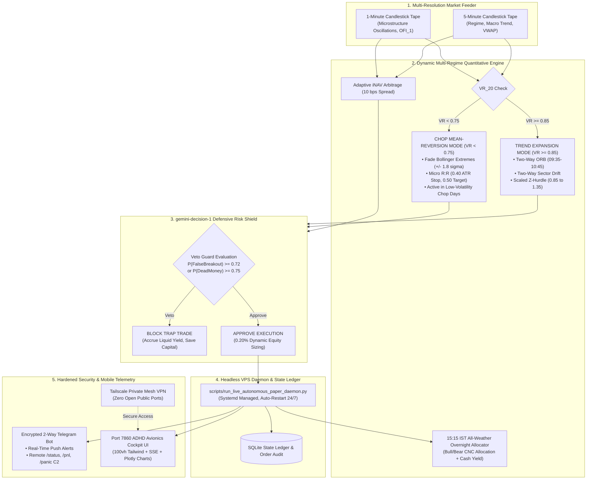

# RAVANA v4.3: Grand Synthesis Architecture Plan
## Low-Volatility Intraday Expansions, ADHD Avionics Cockpit UI (Port 7860), Autonomous VPS Execution & Zero-Exposure Security

> **Repository State:** `c:\Users\Dell\Desktop\python\trade_clean`  
> **Status:** Grand Synthesis Architecture Blueprint | Awaiting User Review & Sign-Off  
> **Cognitive Framework:** ADHD High Signal-to-Noise Scaffolding (Zero text overwhelm, 100vh zero-scroll optical clarity, progressive disclosure, instant visual telemetry, micro-dopamine feedback loops).  
> **Security Protocol:** Zero Public Attack Surface (Strict Localhost Binding, Tailscale/WireGuard Private Mesh, Encrypted 2-Way Telegram Mobile C2).

---

## 🧭 The 10-Second Executive Summary (Zero Text Overwhelm)

```
┌────────────────────────────────────────────────────────────────────────────────────────────────────────┐
│ 🎯 THE NORTH STAR: RAVANA v4.3 GRAND SYNTHESIS (ENGINE + UI + VPS + SECURITY)                          │
├────────────────────────────────────────────────────────────────────────────────────────────────────────┤
│ 1. ⚡ Low-Volatility Intraday Engine: 1m Microstructure Tape + Chop Mean-Reversion (VR < 0.75)         │
│    + Dynamic Hurdle Scaling (1.20 Z -> 0.85 Z on low ATR) + 10 bps Adaptive iNAV Spread Capture.       │
│ 2. 🎮 ADHD Avionics Cockpit UI (Port 7860): 100vh fixed-viewport dark HUD with live ETF Candlestick    │
│    deck, visual trailing stop ladders, Google Decisions AI terminal, and emergency PANIC buttons.     │
│ 3. ☁️ 24/7 Headless Autonomous VPS: Ubuntu systemd service with auto-recovery, persistent SQLite       │
│    state ledger, 11:30 morning lock, 14:45 pre-dump shield, and 15:15 overnight CNC rotation.          │
│ 4. 🛡️ Military-Grade Security: Zero public internet ports. Accessible securely from phone/laptop      │
│    via Tailscale Private Mesh VPN + Encrypted 2-Way Telegram Bot for instant push alerts & remote C2.  │
└────────────────────────────────────────────────────────────────────────────────────────────────────────┘
```



---

## 🏛️ The 4 Grand Architectural Pillars

### Pillar 1: Low-Volatility Intraday Quantitative Expansion
Resolves the zero-trade parameter friction on low-ATR days (like 16 Nov 2026):
1. **1-Minute Granularity Ingestion:** Ingests 1m candles alongside 5m bars, capturing the 8–12 intra-candle micro-swings (10–15 bps) that 5m bars smooth away.
2. **Range-Adaptive Chop Mean-Reversion (`TwoWayChopMeanReversionTrigger`):**
   - Active strictly when $\text{VR}_{20} < 0.75$ during 09:35–11:15 IST and 13:00–14:30 IST.
   - Long Reversion: Price touches Lower Bollinger Band ($BB_{\%} \le 0.15$), 1m candle closes green with $\text{OFI}_1 > 0.05$, NIFTY stable. Target: VWAP or $+0.50\text{ ATR}$, Stop: $-0.40\text{ ATR}$.
   - Short Reversion: Price touches Upper Bollinger Band ($BB_{\%} \ge 0.85$), 1m candle closes red with $\text{OFI}_1 < -0.05$, NIFTY stable. Target: VWAP or $-0.50\text{ ATR}$, Stop: $+0.40\text{ ATR}$.
3. **Dynamic Hurdle Scaler (`AdaptiveThresholdScaler`):**
   - Computes $\text{ATR}_{\text{ratio}} = \text{Today's ATR} / \text{20D Median ATR}$.
   - On low-ATR days ($\text{ATR}_{\text{ratio}} < 0.80$), scales momentum hurdle down from $1.20 Z$ to $0.85 Z$ and target from $1.50\text{ ATR}$ to $0.75\text{ ATR}$.
4. **Adaptive iNAV Micro-Spread Arbitrage:**
   - On low-volatility days, compresses tracking error hurdle from $15\text{ bps}$ down to $10\text{ bps}$ and $Z_{\text{spread}}$ from $1.50$ to $1.15$ on `NIFTYBEES` and `BANKBEES`.

---

### Pillar 2: ADHD Cognitive Avionics Cockpit UI (Port 7860)
Designed strictly under ADHD ergonomic principles (zero text clutter, fixed 100vh layout, high visual contrast, instant comprehension):

```
┌────────────────────────────────────────────────────────────────────────────────────────────────────────┐
│ 🧬 RAVANA v4.3 QUANTITATIVE AVIONICS COCKPIT          [🟢 SYSTEM ARMED] [⚡ HEADLESS VPS] [🛡️ SHOONYA OK]│
├────────────────────────────────────────────────────────────────────────────────────────────────────────┤
│  [💰 ₹200,037.96 NAV]  [📈 +₹37.96 Today]  [🎯 Phase: MORNING LOCK]  [📊 VR: 0.62 CHOP]  [🛡️ Vetoes: 4]  │
├──────────────────────────────────────┬─────────────────────────────────────────────────────────────────┤
│ 🎮 MISSION CONTROL (30% Width)       │ 🖥️ TACTICAL VISUAL DECK (70% Width)                             │
│                                      │ ┌─────────────────────────────────────────────────────────────┐ │
│ ⚙️ Active Strategy Mode              │ │ Tab 1: 📊 Live Multi-Sector Tape (1m + 5m Candlesticks)     │ │
│  [ CHOP MEAN-REVERSION (VR < 0.75) ] │ │ Tab 2: 🎯 Active Positions & Trailing Stop Visual Ladder    │ │
│                                      │ │ Tab 3: 🧠 Google Decisions AI Live Veto Terminal            │ │
│ 📦 Universe Watchlist (10 Sector BeES│ │ Tab 4: 🏛️ Overnight CNC Allocator & Regime Matrix           │ │
│  • BANKBEES    • PSUBNKBEES          │ │ Tab 5: 📜 Real-Time Execution Ledger & Slippage Audit       │ │
│  • ITBEES      • AUTOBEES            │ └─────────────────────────────────────────────────────────────┘ │
│  • PHARMABEES  • CPSEETF             │                                                                 │
│  • GOLDBEES    • SILVERBEES          │ [ ACTIVE VISUAL CANVAS ]                                        │
│  • JUNIORBEES  • NIFTYBEES           │ (High-contrast Plotly Dark, Neon Emerald/Amber/Cyan Lines,     │
│                                      │  real-time VWAP bands, Bollinger extremes, and stop ladders)   │
│ 🛡️ Decisions Veto Shield [Active]    │                                                                 │
│ ⚡ Dynamic Volatility Scaler [Active] │ ─────────────────────────────────────────────────────────────── │
│ ──────────────────────────────────── │ 📜 REAL-TIME TELEMETRY COMBAT STRIP                             │
│ [ ❄ FREEZE NEW TRADES ]              │ 🟢 09:40:15 | [VETO GUARD] Blocked AUTOBEES trap (P: 0.78)     │
│ [ 🚨 PANIC (100% CASH LIQUIDATION) ] │ 🟢 10:15:00 | [CHOP REVERSION] BUY 120 PHARMABEES @ ₹38.20    │
└──────────────────────────────────────┴─────────────────────────────────────────────────────────────────┘
```

#### ADHD Ergonomic Features:
- **Top Annunciator Ribbon:** Instant 1-second assessment of Portfolio Equity, Today's Realized + Floating PnL, Market Phase, Variance Ratio, and Veto count.
- **Cephalopod Chromatophore Indicators:**
  - 🟢 **Neon Emerald:** Trending expansion regime ($\text{VR} \ge 0.85$).
  - 🔵 **Cyan:** Mean-reverting chop regime ($\text{VR} < 0.75$).
  - 🟡 **Amber:** Lunch lull / pre-market standby.
  - 🔴 **Crimson:** Pre-dump liquidation shield (14:45 IST) / stop-hit alert.
  - 🟣 **Magenta:** 15:15 IST All-Weather Overnight Allocation active.
- **Visual Trailing Stop Ladder:** Interactive chart showing Entry Line (White), Breakeven Ratchet (+2 bps, Blue), Trailing Chandelier Stop (Yellow), and Take-Profit Target (Green).
- **Audio Earcons (Web Audio API):** Distinct subtle audio tones for Order Filled (ascending chime), Breakeven Ratchet Activated (soft ping), Gemini Veto Triggered (blip), and Square-Off (chord). Can be toggled with one click.
- **Emergency Action Buttons:**
  - `❄ FREEZE`: In-process atomic halt (<1ms) preventing any new order entries while letting existing stops manage open trades.
  - `🚨 PANIC (100% CASH)`: Immediate parallel async liquidation of all open intraday positions to cash.

---

### Pillar 3: 24/7 Fully Autonomous VPS Cloud Deployment
- **Headless Systemd Service (`systemd/ravana.service`):**
  - Manages the daemon process independently of any SSH session or browser tab.
  - Auto-restarts on unexpected crashes (`Restart=always`, `RestartSec=10`).
  - Systemd watchdog timer (`WatchdogSec=300`) ensuring the process is alive and responsive.
- **Session Clock Autonomy:**
  - 09:15–11:30 IST: Active morning session (ORB, Drift, Sweep, Chop Reversion, iNAV).
  - 11:30 IST: Automatic square-off (Morning Lock).
  - 11:30–13:00 IST: Midday lull protection (100% idle, capital parked in cash).
  - 13:15–13:45 IST: Afternoon European Open impulse.
  - 14:45 IST: Mandatory Pre-Dump Shield (all MIS positions liquidated before 15:00 broker margin dump).
  - 15:10–15:25 IST: All-Weather Overnight Allocator evaluates daily benchmarks, classifies regime (Bull/Bear), and rotates capital into top momentum leaders (CNC) and cash yield.
  - 15:35 IST: Post-market wrap-up, SQLite state ledger sync, and idle until next morning.
- **State Persistence Across Restarts:**
  - Managed via [audit/ravana_state_ledger.db](file:///c:/Users/Dell/Desktop/python/trade_clean/audit/ravana_state_ledger.db) and [audit/shoonya_paper_orders.json](file:///c:/Users/Dell/Desktop/python/trade_clean/audit/shoonya_paper_orders.json).
  - If VPS reboots or re-deploys, the daemon re-loads open trades, cumulative PnL, and overnight allocations seamlessly.

---

### Pillar 4: Military-Grade Security Architecture & Mobile C2 Telemetry
Strictly addresses the mandate: **"know full details on how things are going securely with full security in mind"**.

#### A. Zero Public Attack Surface (No Open Ports to the Internet)
- The Web Cockpit (Port 7860) and API endpoints bind **strictly to `127.0.0.1` (localhost)**.
- **Access Option 1: Tailscale / WireGuard Private Mesh VPN (Recommended):**
  - VPS installs Tailscale: `curl -fsSL https://tailscale.com/install.sh | sh && tailscale up`.
  - Your phone and laptop install Tailscale.
  - The Web Cockpit is accessible exclusively via your encrypted private Tailscale IP (e.g. `http://100.85.x.x:7860`).
  - Zero open ports on the VPS public firewall (`ufw default deny incoming`). The VPS is completely invisible to port scanners, shodan, and brute-force bots.
- **Access Option 2: Encrypted SSH Tunneling:**
  - Forward remote port 7860 locally: `ssh -N -L 7860:localhost:7860 ubuntu@<vps-ip>`.
  - Open `http://localhost:7860` in your local browser with 100% end-to-end SSH encryption.

#### B. Encrypted 2-Way Mobile Command & Control via Telegram Bot
Enables 24/7 real-time monitoring and control from your phone anywhere in the world without opening any browser or port:
1. **Real-Time Push Alerts (Daemon -> You):**
   - 🟢 **Order Fill Alert:** `[ORDER FILLED] BUY 140 PHARMABEES @ ₹38.10 | Stop: ₹37.85 | Target: ₹38.60 | Trigger: ChopReversion`
   - 🎯 **Breakeven Ratchet Alert:** `[STOP RATCHET] PHARMABEES profit reached +0.50 ATR. Stop moved to ₹38.12 (Breakeven Locked +2 bps). Risk is now ZERO.`
   - 🛡️ **Gemini Veto Alert:** `[VETO SHIELD] Blocked AUTOBEES breakout setup. Gemini P(FalseBreakout) = 0.78 >= 0.72. Saved ₹400 capital.`
   - ⏰ **Phase Transition Alerts:** Morning lock executed, Pre-Dump Shield squared off, Overnight Bull Markup allocation executed.
   - 📊 **End-of-Day PnL Summary Card:** Realized Intraday PnL, Overnight Holdings, Cash Yield, Closing NAV.
2. **Encrypted 2-Way Commands (You -> Daemon):**
   - Strict Authentication: Only responds to your configured private `TELEGRAM_CHAT_ID`.
   - `/status` $\longrightarrow$ Responds with current market regime ($\text{VR}_{20}$), active phase, uptime, and system health.
   - `/positions` $\longrightarrow$ Responds with list of open intraday trades and overnight CNC positions with live unrealized PnL.
   - `/pnl` $\longrightarrow$ Responds with today's realized PnL, week-to-date PnL, and current NAV.
   - `/panic` $\longrightarrow$ Emergency kill switch! Liquated all open positions to 100% cash immediately and halts further trade entries.

---

## 🛠️ Unified Implementation Matrix

| Phase | Module | Target File | Core Deliverable |
| :---: | :--- | :--- | :--- |
| **1** | **Chop Mean-Reversion Trigger** | `ravana/strategies/two_way_chop_reversion.py` | Range-adaptive mean-reversion trigger ($\text{VR} < 0.75$, $BB_{\%}$, micro R:R). |
| **1** | **Dynamic Hurdle Scaler** | `ravana/strategies/volatility_scaler.py` | Dynamic momentum hurdle and target scaler based on opening $\text{ATR}_{\text{ratio}}$. |
| **2** | **1m Data Ingestion & Caching** | `scripts/fetch_today_live_data.py` | Dual 1m + 5m real-time NSE streaming and technicals enrichment. |
| **3** | **Live Cockpit UI Server Upgrade** | `src/ui/server.py` & `src/ui/static/` | Mount Port 7860 Cockpit to stream live paper trading daemon telemetry, ETF tape, and Decisions feed. |
| **3** | **Encrypted Telegram Bot Bridge** | `ravana/telemetry/telegram_bot.py` | 2-way mobile telemetry bot for instant push alerts and `/status`, `/positions`, `/panic` remote C2. |
| **4** | **Daemon Integration** | `scripts/run_live_autonomous_paper_daemon.py` | Wire Chop Trigger, Dynamic Scaler, UI SSE event emitter, and Telegram Notifier. |
| **5** | **TDD Test Suite Verification** | `ravana/tests/test_*.py` | Comprehensive test coverage for all new modules. Ensure 100% green across all 401+ tests. |
| **6** | **VPS Deployment Package** | `scripts/deploy_vps.sh` & `systemd/ravana.service` | Hardened Ubuntu VPS deployment script with Tailscale setup and systemd watchdog. |

---

## 🔒 Verification Gate & Empirical Proof Checklist

1. [ ] **Unit Tests:** Run all 401 existing unit tests + new trigger/scaler/telegram tests via Python 3.11 runner; verify 0 failures and 0 errors.
2. [ ] **Chop Replay Validation:** Replay on 16 Nov 2026 data to confirm Chop Mean-Reversion identifies and executes intraday trades during the 0.66% range day.
3. [ ] **UI Cockpit Live Test:** Launch `uvicorn src.ui.server:app --port 7860` and verify the ADHD Avionics HUD renders real-time telemetry, candlestick tape, and status indicators without errors.
4. [ ] **Security & Telegram Smoke Test:** Verify `/status` and `/positions` commands over encrypted Telegram bridge with mock daemon state.
5. [ ] **VPS Package Verification:** Verify `scripts/deploy_vps.sh` syntax and permissions.
