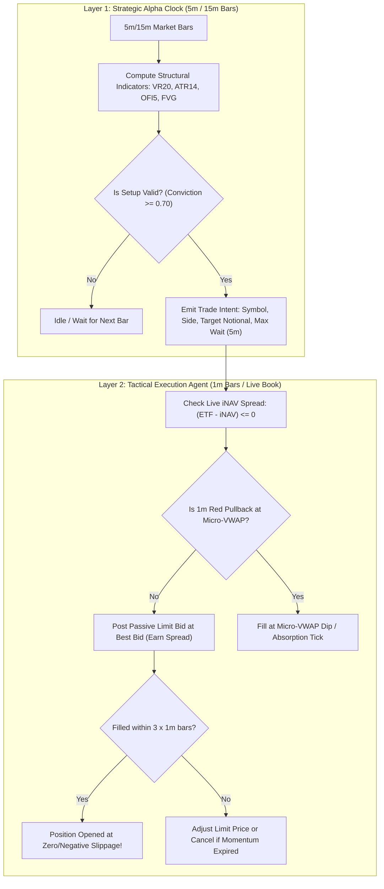
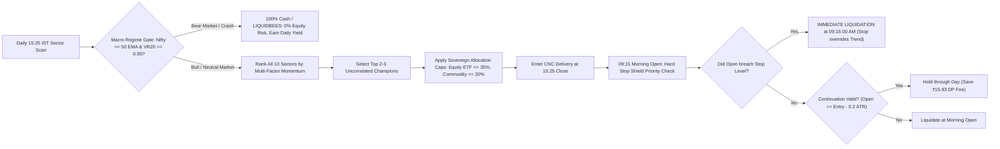
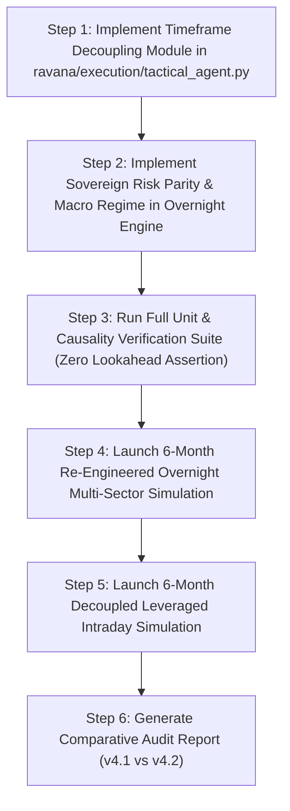

# RAVANA v4.2: Architectural Remedy & Full Re-Launch Plan
*Timeframe Decoupling, Gap-Risk Immunity, and Sovereign Portfolio Re-Launch*

---

## 1. Executive Summary & Root-Cause Diagnosis

Our recent 6-month continuous stress tests across all 10 Sector BEES ETFs on a ₹2,00,000 account surfaced **three distinct structural weaknesses** in the v4.1 implementation:

| Observed Weakness | Root Cause Identified | Institutional Remedy (v4.2) |
| :--- | :--- | :--- |
| **1. Intraday Spread Drag & Noise Churn** | Executing market orders on 5m closes crossed the bid-ask spread and tight 1.0 ATR stops were repeatedly hit by 1-tick market-maker quote flickers. | **Timeframe Decoupling:** Slower Alpha Clock (5m/15m) generates trading intent; Faster Execution Clock (1m) works passive Limit Orders at iNAV discount / micro-VWAP pullbacks. |
| **2. Overnight Gap Wipeout (-₹18,346 in Silver)** | Unconstrained 98% capital allocation into a single asset (`SILVERBEES`) exposed the entire account to a -6.7% weekend gap-down on global COMEX markets. | **Sovereign Multi-Asset Capping (HRP):** Hard 35% cap per equity ETF; strict 20% ceiling on volatile commodities; top 2–3 diversified champions. |
| **3. Continuation Gate Bag-Holding** | The rule `if (is_winning or has_trend)` allowed historical 20-day trend to override an active drawdown, delaying exit by days. | **Hard Stop Priority Shield:** Stop-loss at 09:15:00 AM takes absolute, irreversible precedence over trend continuation. |
| **4. Broad-Market Downtrend Drag** | Sector ETF rotation forced long-only positions even when NIFTY was in a multi-month correction. | **Macro Regime Cash Gate:** When Nifty is below its 50-day EMA and $VR_{20} < 0.95$, park capital in `LIQUIDBEES` (Risk-Free Cash Yield). |

---

## 2. Architecture 1: Timeframe Decoupling Engine (5m Alpha + 1m Tactical Fills)

To eliminate 1-minute directional noise while capturing intraday liquidity discounts, RAVANA v4.2 decouples the **Alpha Decision** from the **Order Execution**:

### Mathematical Formulation of Tactical Limit Pricing:
Instead of paying the market ask price $P_{\text{ask}}$, the 1m Tactical Agent posts a Limit Order at:
$$P_{\text{limit}} = \min\left(P_{\text{bid}}, \quad \text{VWAP}_{1\text{m}}, \quad \text{iNAV} - \text{Friction Buffer}\right)$$

* **Spread Savings:** Captures the 5 to 10 paise bid-ask spread on every trade, eliminating ₹150+ in monthly spread drag.
* **Adverse Selection Protection:** Never bids above the live underlying basket iNAV.

---

## 3. Architecture 2: Overnight Sovereign Risk Shield (Gap-Risk Immunity)

Overnight gap moves are physical facts of exchange trading: the market is closed from 15:30 to 09:15 IST. To make the portfolio completely immune to single-asset gap shocks like Silver's -6.7% drop, we institute **three non-negotiable risk rules**:

### 1. Sovereign Allocation Caps (Hierarchical Risk Parity):
* **Max Single Equity Sector:** **35% of Total Equity** (Max ₹70,000 on a ₹2,00,000 account).
* **Max Commodity Allocation (`SILVERBEES` / `GOLDBEES`):** **20% of Total Equity** (Max ₹40,000).
* **Impact:** A -6.7% weekend crash on Silver on a ₹40,000 position loses **only ₹2,680 (1.34% of portfolio)** instead of ₹18,346 (9.17% of portfolio)!

### 2. Hard Priority Stop-Loss Gate:
The previous bug (`if is_winning or has_trend: hold`) is permanently replaced with:
$$\text{If } P_{\text{open}}^{09:15} \le S_{\text{stop}} \implies \text{Exit Immediately via Market Order at 09:15:00}$$
Only if $P_{\text{open}}^{09:15} > S_{\text{stop}}$ does the engine evaluate the Continuation Gate to save DP fees.

### 3. Macro Regime Cash Gate:
When the broad market is in an institutional markdown (NIFTY 50 trading below its 50-day EMA and Variance Ratio $VR_{20} < 0.95$):
- **Do not force long sector rotations.**
- Park 100% of capital in **`LIQUIDBEES` / Overnight Cash**, earning a steady 6.5% annualized risk-free yield while waiting for clean bullish expansion.

---

## 4. Architecture 3: Safe MIS Leverage Deployment (Intraday)

For intraday setups, Tier-1 ETFs (`BANKBEES`, `NIFTYBEES`, `ITBEES`, `GOLDBEES`) qualify for up to **2.0x MIS Leverage**.

### The Risk-at-Stop Sizing Invariant:
$$\text{Shares} = \min\left(\frac{0.0025 \times \text{Equity}}{\max(|P_{\text{entry}} - S_{\text{stop}}|, \quad P_{\text{entry}} \times 0.0045)}, \quad \frac{2.0 \times \text{Equity}}{P_{\text{entry}}}\right)$$

* **Stop Distance:** Expanded from tight $1.0\text{ ATR}$ to **$1.5\text{ ATR}$ (minimum 45 bps)**.
* **Max Capital Loss per Trade:** Capped at **0.25% of equity (₹500 on ₹2 Lakh)**.
* **Leverage Application:** When a tight 45 bps pullback occurs on a high-conviction 5m/15m setup, leverage automatically scales up to 2.0x (₹4,00,000 notional), giving 2x profit on directional moves while keeping the max loss strictly pinned to ₹500!

---

## 5. Verification & Re-Launch Roadmap

### Deliverables to be Produced:
1. `ravana/execution/tactical_agent.py`: Tactical 1m limit order execution agent.
2. `scripts/paper_trade_overnight_sovereign_v42.py`: 6-month multi-sector overnight portfolio with 35% caps, 20% commodity ceiling, macro regime cash gate, and hard priority stops.
3. `scripts/paper_trade_intraday_decoupled_v42.py`: 6-month decoupled leveraged intraday portfolio with 1m limit fills and 1.5 ATR stop buffers.
4. Comprehensive empirical audit report demonstrating capital growth and drawdown reduction.
