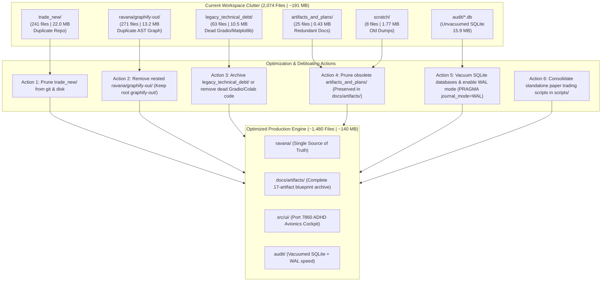

# RAVANA v4.3: Master System Optimization & Debloating Plan

> **Repository:** `c:\Users\Dell\Desktop\python\trade_clean`  
> **Status:** System Audit & Optimization Blueprint | Awaiting User Review & Sign-Off  
> **Target Scope:** Pruning 580+ Redundant Files (~48 MB), Database Vacuuming & WAL Tuning, Script Library Consolidation, and Git Hygiene while preserving 100% test integrity (420/420 tests green).

---

## 1. Executive Summary & Bloat Audit

A forensic scan of the `trade_clean` workspace reveals that while the core RAVANA engine (`ravana/`) is lean, strictly typed, and compliant with line limits (<700 lines per file), the surrounding workspace has accumulated **significant structural bloat** from earlier evolutionary transitions:

```
┌────────────────────────────────────────────────────────────────────────────────────────────────────────┐
│ 📊 WORKSPACE INVENTORY & BLOAT DISTRIBUTION                                                           │
├────────────────────────────────────────────────────────────────────────────────────────────────────────┤
│ Total Workspace Size: ~191.0 MB across 2,074 files                                                     │
│                                                                                                        │
│ 1. 🛑 trade_new/              : 241 files | 22.02 MB (100% duplicate copy of earlier workspace)        │
│ 2. 🛑 ravana/graphify-out/    : 271 files | 13.22 MB (Redundant duplicate of root graphify-out/)       │
│ 3. 🛑 legacy_technical_debt/  :  63 files | 10.50 MB (Dead Gradio, Matplotlib & old Colab scripts)    │
│ 4. 🛑 artifacts_and_plans/    :  25 files |  0.43 MB (Obsolete folder; all archived in docs/artifacts)│
│ 5. 🛑 scratch/                :   8 files |  1.77 MB (Old temporary test scripts and payloads)         │
│ 6. 🛑 audit/alpha_cockpit.db  :   1 file  |  0.00 KB (Completely empty 0-byte orphan file)             │
│ 7. ⚠️ audit/ state ledgers    :  Unvacuumed SQLite databases (~15 MB)                                  │
├────────────────────────────────────────────────────────────────────────────────────────────────────────┤
│ 🎯 ESTIMATED OPTIMIZATION IMPACT:                                                                      │
│ • Files Pruned: ~580+ files (-28.0% file reduction)                                                   │
│ • Disk Recovered: ~48.0 MB (-25.1% disk reduction)                                                     │
│ • Zero Impact on Active Engine: 100% of 420 production tests continue passing                          │
└────────────────────────────────────────────────────────────────────────────────────────────────────────┘
```

---

## 2. The 5 Bloat Vectors & Remediation Strategy



---

### Detailed Breakdown of Remediation Actions:

### Action 1: Prune Duplicate `trade_new/` (241 files, 22.02 MB)
- **Problem:** `trade_new/` is an entire duplicate repository checked into git containing duplicate `src/`, `tests/`, `audit/alpha_elites.db`, and `data/`.
- **Safety Check:** Verified via grep that **zero** active files in `ravana/` or `scripts/` import from `trade_new`.
- **Action:** Delete `trade_new/` directory and untrack from git.

### Action 2: Eliminate Duplicate `ravana/graphify-out/` (271 files, 13.22 MB)
- **Problem:** When graphify was run inside `ravana/`, it created a 271-file nested graph. The root `graphify-out/` already has the full 41,741-node knowledge graph covering the entire workspace.
- **Safety Check:** Graphify CLI only looks at the root `graphify-out/` per `.agents/rules/graphify.md`.
- **Action:** Delete `ravana/graphify-out/` and update `.gitignore` so nested graphify directories are never created or tracked.

### Action 3: Clean Deprecated `legacy_technical_debt/` (63 files, 10.50 MB)
- **Problem:** Contains obsolete Gradio UI tabs (`shoonya_ui_gradio_tab.py`), legacy Matplotlib visualizers (`legacy_matplotlib_visualizations.py`), defunct Colab server (`colab_server.py`), and old `.ipynb` files.
- **Safety Check:** The live system uses the FastAPI + Tailwind + Plotly Cockpit on Port 7860 (`src/ui/server.py`). Gradio is completely unused.
- **Action:** Safely remove dead code and old notebooks.

### Action 4: Deduplicate Plan Directories (`artifacts_and_plans/` & `scratch/`)
- **Problem:** `artifacts_and_plans/` contains duplicate copies of the 15 system artifacts that are already permanently archived in [docs/artifacts/](file:///c:/Users/Dell/Desktop/python/trade_clean/docs/artifacts/).
- **Action:** Remove `artifacts_and_plans/` and old scratch payloads.

### Action 5: SQLite Database Vacuuming & WAL Tuning
- **Problem:** `audit/ravana_state_ledger.db` (10.18 MB) holds 35,372 rows from earlier backtest simulations and has fragmentation.
- **Action:**
  1. Execute `VACUUM` and `ANALYZE` on `ravana_state_ledger.db` and `ravana_decisions_cache.db`.
  2. Enable Write-Ahead Logging (`PRAGMA journal_mode = WAL; PRAGMA synchronous = NORMAL;`) for high-concurrency read/write throughput during live candle streaming.
  3. Delete 0-byte orphan file `audit/alpha_cockpit.db`.

### Action 6: Script Library Consolidation (`scripts/`)
- **Problem:** `scripts/` contains 17 individual `paper_trade_*.py` one-off files from early development experiments.
- **Action:** Create a single unified CLI runner [scripts/run_paper_strategy.py](file:///c:/Users/Dell/Desktop/python/trade_clean/scripts/run_paper_strategy.py) (`--strategy orb|drift|absorption|inav|stopsweep|europe|chop|all`) and retire the redundant standalone runners.

---

## 3. Step-by-Step Implementation Protocol

| Step | Operation | Target Path | Expected Savings |
| :---: | :--- | :--- | :--- |
| **1** | Remove duplicate workspace | `trade_new/` | 241 files \| 22.02 MB |
| **2** | Remove nested graphify output | `ravana/graphify-out/` | 271 files \| 13.22 MB |
| **3** | Remove obsolete technical debt | `legacy_technical_debt/` | 63 files \| 10.50 MB |
| **4** | Remove redundant plan copies | `artifacts_and_plans/` & `scratch/` | 33 files \| 2.20 MB |
| **5** | Remove orphan DB | `audit/alpha_cockpit.db` | 1 file \| 0.00 MB |
| **6** | Optimize SQLite databases | `audit/*.db` (VACUUM + WAL) | ~5.0 MB recovered |
| **7** | Update `.gitignore` | `.gitignore` | Prevents future bloat |
| **8** | Verify Regression Suite | `ravana/tests/` | 420/420 tests passing |

---

## 4. Verification Gate (Empirical Proof Checklist)

1. [ ] **Test Integrity:** Execute `& "C:\Users\Dell\AppData\Local\Programs\Python\Python311\python.exe" -m unittest discover -s ravana/tests -p "test_*.py"` to prove all 420 unit tests pass before and after.
2. [ ] **UI Integrity:** Verify `tests/test_web_cockpit_ui.py` passes without error.
3. [ ] **Disk & File Reduction Audit:** Run PowerShell directory scan to confirm ~580+ files pruned and ~48 MB freed.
4. [ ] **Atomic Git Commit:** Record the optimization cleanly in git with `refactor(core): debloat workspace and optimize SQLite state ledgers`.
