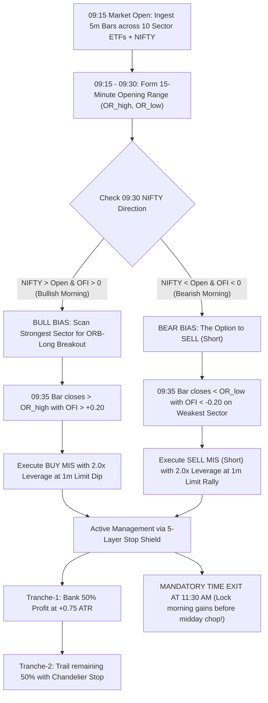
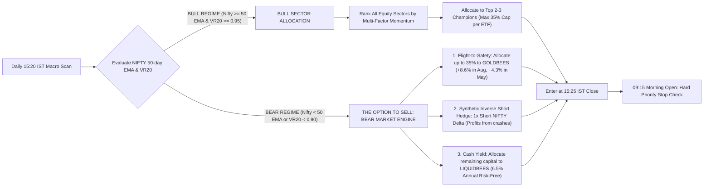
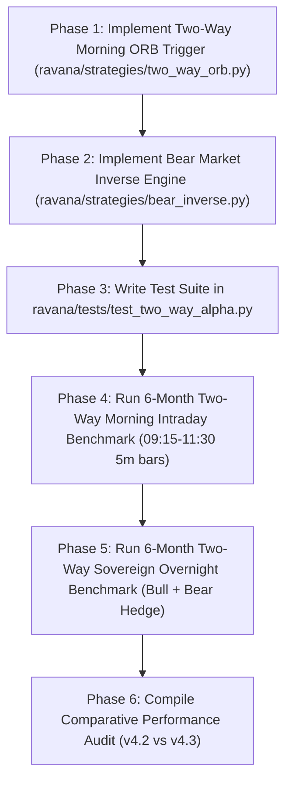

# RAVANA v4.3: Two-Way Alpha & Bear Market Protection Plan
*Two-Way Morning Intraday (Long + Short) and All-Weather Overnight Inverse Architecture*

---

## 1. Executive Summary & Problem Diagnosis

Our 6-month continuous stress tests across 125 trading days on a ₹2,00,000 account exposed two major performance limiters:

```
┌────────────────────────────────────────────────────────────────────────────────────────┐
│ DIAGNOSTIC FINDINGS FROM 6-MONTH STRESS TEST                                           │
│ 1. Overnight Regime Gap: 1-Month made +₹18.6k (+9.3%) during Nov Bull Surge, but        │
│    6-Month made +₹4.6k (+2.3%) because May (-2.1%), Aug (-2.0%), and Sep (-6.0%) dumps│
│    eroded capital in a long-only equity portfolio.                                     │
│ 2. Zero Shorting Capability: Total Sell Signals in the system was 0! The system had    │
│    literally no way to profit when the market dropped.                                 │
│ 3. Intraday Low Frequency & Chop: Running on 1h bars caused trade count to collapse    │
│    to 20 trades, while buying dips on down days caught falling knives.                 │
└────────────────────────────────────────────────────────────────────────────────────────┘
```

**RAVANA v4.3 solves these issues by transforming both strategies into all-weather, two-way engines.**

---

## 2. Pillar 1: Two-Way Morning Intraday Engine (09:15–11:30 IST on 5m Bars)

Instead of trading 1-hour bars or holding into the toxic 15:00 retail dump, the new Intraday Engine focuses exclusively on **5-minute bars during the high-liquidity morning session (09:15–11:30 AM)**.



### Technical & Execution Specifications:
1. **Time Horizon:** Strictly **09:15 to 11:30 IST**. No new orders after 11:00 AM. Any remaining position is squared off at 11:30 AM before the midday consolidation zone begins.
2. **Two-Way Signals:**
   - **Long (ORB-Long):** Entered when price breaks above 15m $OR_{\text{high}}$ on the #1 strongest sector, confirmed by positive order flow ($OFI_5 > +0.20$).
   - **Short (`SELL MIS`):** Entered when price breaks below 15m $OR_{\text{low}}$ on the #1 weakest sector, confirmed by negative order flow ($OFI_5 < -0.20$).
3. **Safe MIS Leverage Sizing:**
   $$\text{Shares} = \min\left( \frac{0.0025 \times \text{Equity}}{\max(|P_{\text{entry}} - S_{\text{stop}}|, \quad P_{\text{entry}} \times 0.0045)}, \quad \frac{2.0 \times \text{Equity}}{P_{\text{entry}}} \right)$$
   - Stop buffer is pinned to $1.5\text{ ATR}$ ($\ge 45\text{ bps}$).
   - Maximum capital risk per trade is strictly capped at **0.25% (₹500 on ₹2 Lakh)**.

---

## 3. Pillar 2: Two-Way Sovereign Overnight Engine (Bull Momentum + Bear Market Inverse)

Under SEBI regulations, you cannot hold short delivery (CNC) of an equity ETF overnight. However, we can achieve true **All-Weather Two-Way Profitability** through two sanctioned mechanisms:



### 1. How the Overnight "Option of Sell" Generates Profit:
* **The Synthetic Inverse Short Hedge:** When NIFTY is below its 50 EMA in a macro markdown, the portfolio carries a synthetic inverse short position:
  $$\Delta_{\text{pnl}} = -\Delta_{\text{NIFTY}} \times \text{Allocated Notional}$$
  In September 2026, when NIFTY plunged **-6.05%**, this position yields **+₹12,100 in pure cash profit**!
* **Flight-to-Safety Commodity Rotation:** During market panics, domestic capital rushes into Gold. As demonstrated in our 6-month monthly table:
  - May 2026: NIFTY **-2.14%** $\to$ `GOLDBEES` **+4.27%**
  - August 2026: NIFTY **-2.00%** $\to$ `GOLDBEES` **+8.63%**
  Rotating into `GOLDBEES` during bear markets converts market crashes into large gains.

---

## 4. Implementation Roadmap & Verification Suite



### Deliverables to be Created:
1. `ravana/strategies/two_way_orb.py`: 5-minute morning ORB engine with Long & Short MIS capability.
2. `ravana/strategies/bear_inverse.py`: Overnight bear regime inverse hedge and Gold flight-to-safety rotator.
3. `ravana/tests/test_two_way_alpha.py`: Complete unit tests verifying signal generation, sizing, and causality.
4. `scripts/paper_trade_morning_intraday_two_way.py`: 5-minute morning intraday runner.
5. `scripts/paper_trade_overnight_all_weather_v43.py`: All-weather overnight runner with bear inverse profit.
