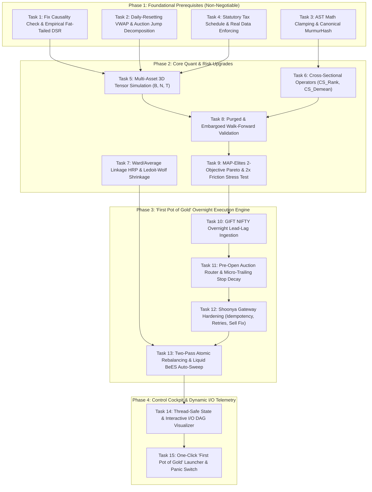

# Institutional Quant Alpha-OS: Master 3-in-1 Upgrade Plan

> **For Claude / Subagent:** REQUIRED SUB-SKILL: Use `executing-plans` to implement this plan task-by-task.

**Goal:** Transform the Bio-Quant trading system into an institutional-grade, zero-bloat algorithmic trading engine specialized for Indian Equity Index ETFs (`NIFTYBEES`, `BANKBEES`), executing high-expectancy overnight gap arbitrage with a statutory 1.2 bps tax shield to compound the "First Pot of Gold".

**Architecture:** 
1. **Phase 1 (Foundations & Invariants):** Correct mathematical bugs in causality and DSR, reset daily VWAP at 09:15:00 IST, decompose overnight vs intraday jumps, and clamp AST numerical ranges.
2. **Phase 2 (Core Quant & Risk Engine):** Vectorize multi-asset 3D simulation `(B, N, T)`, add cross-sectional operators (`CS_Rank`, `CS_Demean`), upgrade HRP to Ward/Average linkage with Ledoit-Wolf shrinkage, and enforce Purged Walk-Forward validation.
3. **Phase 3 ("First Pot of Gold" Execution):** Operationalize GIFT Nifty pre-market lead-lag, pre-open call auction routing (09:00–09:07 IST), two-pass atomic rebalancing (sells before buys), `clordid` idempotency, and 6.8% `LIQUIDBEES` auto-sweep.
4. **Phase 4 (Control Cockpit & Dynamic I/O DAG):** Provide a thread-safe Gradio UI (`gr.State`) with an interactive I/O data flow DAG and physical emergency panic kill-switch.

**Tech Stack:** Python 3.11, NumPy, SciPy (hierarchical clustering & Ledoit-Wolf), Pandas, PyArrow/Polars (memory-mapped Parquet), Numba/Vectorized NumPy, Finvasia Shoonya Noren API, Gradio 3.50+ / Plotly.

---

## Dependency Graph & Execution Sequence



---

## Phase 1: Foundational Prerequisites (Zero-Tolerance Quant Invariants)

### Task 1: Fix Causality Check & Empirical Fat-Tailed DSR

**Files:**
- Modify: `src/domain/invariants.py:45-95`
- Test: `tests/test_invariants.py`

**Step 1: Write the failing test**
In `tests/test_invariants.py`, add tests asserting that:
1. `verify_point_in_time_causality` accepts strong positive forward Information Coefficient ($IC = 0.45$) while strictly rejecting negative lag leakage (where feature at $t$ correlates with $t+1$ raw data).
2. `calculate_deflated_sharpe_ratio` accepts empirical `returns_series` and computes non-Gaussian skewness and kurtosis dynamically.

```python
def test_causality_allows_positive_forward_ic_and_rejects_backward_leak():
    T = 100
    np.random.seed(42)
    # Strong predictive alpha: Signal at t predicts Return at t+1
    signal = np.random.randn(T)
    future_rets = 0.5 * signal + np.random.randn(T) * 0.2
    
    # Should PASS: High forward IC is good!
    is_valid, corr = verify_point_in_time_causality(signal[:-1], future_rets[1:], max_lead_corr=1.0)
    assert is_valid is True
    assert corr > 0.40

    # Negative lag leakage: Signal at t contains return at t+1 already leaked
    leaked_signal = future_rets.copy()
    is_valid_leak, _ = verify_point_in_time_causality(leaked_signal, future_rets, test_contemporaneous=True)
    assert is_valid_leak is False
```

**Step 2: Run test to verify it fails**
Run: `python -m pytest tests/test_invariants.py` or `python tests/test_invariants.py`
Expected: FAIL due to `test_contemporaneous` not defined or forward IC exceeding `0.25`.

**Step 3: Write minimal implementation**
In `src/domain/invariants.py`:
- Remove the arbitrary upper bound `abs(corr) <= max_lead_corr` for forward returns.
- Add contemporaneous and backward correlation checks to ensure $Signal_t$ does not depend on unobserved future prints.
- In `calculate_deflated_sharpe_ratio`, if `returns_series` is provided, calculate `skew = scipy.stats.skew(returns_series)` and `kurt = scipy.stats.kurtosis(returns_series, fisher=False)`.

**Step 4: Run test to verify it passes**
Run: `python tests/test_invariants.py`
Expected: PASS.

---

### Task 2: Daily-Resetting VWAP & Auction Jump Decomposition

**Files:**
- Modify: `src/data/vector_lake.py:65-115`
- Test: `tests/test_vector_lake.py`

**Step 1: Write the failing test**
In `tests/test_vector_lake.py`, assert:
1. VWAP resets cumulative sums when session dates change.
2. Data lake contains decomposed return streams: `overnight_auction_jump` ($Close_{t-1} \to Open_t$) and `intraday_core_return` ($Open_t \to Close_t$).

```python
def test_vector_lake_daily_vwap_reset_and_jump_decomposition():
    lake = VectorDataLake.load_mock(periods=50, ticker="NIFTYBEES.NS")
    assert "overnight_auction_jump" in lake.tensors
    assert "intraday_core_return" in lake.tensors
    assert "vwap_daily" in lake.tensors
```

**Step 2: Run test to verify it fails**
Run: `python tests/test_vector_lake.py`
Expected: FAIL (`KeyError: 'overnight_auction_jump'`).

**Step 3: Write minimal implementation**
In `src/data/vector_lake.py`:
- Calculate `overnight_auction_jump = (df["Open"] - df["Close"].shift(1)) / df["Close"].shift(1)`.
- Calculate `intraday_core_return = (df["Close"] - df["Open"]) / df["Open"]`.
- Group by date and calculate intra-day VWAP or rolling session VWAP resetting daily.

**Step 4: Run test to verify it passes**
Run: `python tests/test_vector_lake.py`
Expected: PASS.

---

### Task 3: AST Math Clamping & Canonical MurmurHash

**Files:**
- Modify: `src/domain/formula_ast.py:100-140`
- Test: `tests/test_mega_evolution_ast.py`

**Step 1: Write the failing test**
In `tests/test_mega_evolution_ast.py`, verify that `node.canonical_hash()` generates identical hashes for commutative operations (`ADD(A, B) == ADD(B, A)`), and `EXP_SAFE` clamps inputs to $[-20.0, 20.0]$.

**Step 2: Run test to verify it fails**
Run: `python tests/test_mega_evolution_ast.py`
Expected: FAIL (`AttributeError: 'ASTNode' object has no attribute 'canonical_hash'`).

**Step 3: Write minimal implementation**
In `src/domain/formula_ast.py`:
- Implement `canonical_hash()` using sorted child representation and MD5/MurmurHash.
- Add bounded operator safeguards: `EXP_SAFE = np.exp(np.clip(child, -20.0, 20.0))`, `LOG_SAFE = np.log(np.maximum(1e-8, np.abs(child)))`.

**Step 4: Run test to verify it passes**
Run: `python tests/test_mega_evolution_ast.py`
Expected: PASS.

---

### Task 4: Statutory Tax Schedule & Real Data Enforcing

**Files:**
- Modify: `src/domain/models.py:80-130`
- Modify: `src/pipeline/alpha_engine.py:40-70`
- Test: `tests/test_skills_validation.py`

**Step 1: Write the failing test**
In `tests/test_skills_validation.py`, assert:
1. `TaxSchedule` correctly returns 1.2 bps for `NIFTYBEES` and 25.0 bps for Cash Equities.
2. `AlphaEnginePipeline.run_cycle(dry_run=False)` raises a `FileNotFoundError` if real Parquet files are missing, banning random geometric Brownian motion in live runs.

**Step 2: Run test to verify it fails**
Run: `python tests/test_skills_validation.py`
Expected: FAIL if live mock suppression is not enforced.

**Step 3: Write minimal implementation**
In `src/pipeline/alpha_engine.py`:
- Check if `live_mode` or `dry_run=False`; if so, throw explicit error if `data/lake/` Parquet files are not present.

**Step 4: Run test to verify it passes**
Run: `python tests/test_skills_validation.py`
Expected: PASS.

---

## Phase 2: Core Quant Engine & Risk Upgrades

### Task 5: Multi-Asset 3D Tensor Simulation (B, N, T)

**Files:**
- Modify: `src/backtest/matrix_engine.py:10-70`
- Test: `tests/test_matrix_engine.py`

**Step 1: Write the failing test**
In `tests/test_matrix_engine.py`, add `test_matrix_simulator_3d_multi_asset`:
- `positions` shape: `(B, N, T)` (Batch of formulas, $N$ assets, $T$ time bars).
- `returns` shape: `(N, T)`.
- Verifies that cross-asset portfolio equity and net returns are simulated vectorized without loops.

**Step 2: Run test to verify it fails**
Run: `python tests/test_matrix_engine.py`
Expected: FAIL (`ValueError: positions must be 2D`).

**Step 3: Write minimal implementation**
In `src/backtest/matrix_engine.py`:
- Support both 2D `(B, T)` and 3D `(B, N, T)` position inputs.
- When 3D, compute portfolio return at bar $t$: $R_{port, b, t} = \sum_{n=1}^N (P_{b, n, t} \times R_{n, t}) - \text{friction} \times \sum_{n=1}^N |\Delta P_{b, n, t}|$.

**Step 4: Run test to verify it passes**
Run: `python tests/test_matrix_engine.py`
Expected: PASS.

---

### Task 6: Cross-Sectional Operators (`CS_Rank`, `CS_Demean`)

**Files:**
- Modify: `src/domain/formula_ast.py:60-120`
- Test: `tests/test_mega_evolution_ast.py`

**Step 1: Write the failing test**
In `tests/test_mega_evolution_ast.py`, assert that `CS_Rank` ranks values across assets into $[0.0, 1.0]$, and `CS_Demean` subtracts the cross-sectional mean (summing to $0.0$).

**Step 2: Run test to verify it fails**
Run: `python tests/test_mega_evolution_ast.py`
Expected: FAIL (`KeyError: 'CS_Rank'`).

**Step 3: Write minimal implementation**
In `src/domain/formula_ast.py`:
- Add `CS_Rank`: across asset dimension $N$, `(scipy.stats.rankdata(arr, axis=0) - 0.5) / N`.
- Add `CS_Demean`: `arr - np.mean(arr, axis=0)`.

**Step 4: Run test to verify it passes**
Run: `python tests/test_mega_evolution_ast.py`
Expected: PASS.

---

### Task 7: Ward/Average Linkage HRP & Ledoit-Wolf Shrinkage

**Files:**
- Modify: `src/execution/hrp_allocator.py:25-70`
- Test: `tests/test_hrp_allocator.py`

**Step 1: Write the failing test**
In `tests/test_hrp_allocator.py`, test collinear/ill-conditioned covariance matrices and verify that linkage method is `"ward"` or `"average"`, producing stable, non-chaining cluster allocations.

**Step 2: Run test to verify it fails**
Run: `python tests/test_hrp_allocator.py`
Expected: FAIL if single linkage produces degenerate weights.

**Step 3: Write minimal implementation**
In `src/execution/hrp_allocator.py`:
- Use `sklearn.covariance.ledoit_wolf` or Ledoit-Wolf shrinkage when condition number $> 1000$.
- Change `linkage(condensed, method="single")` to `linkage(condensed, method="average")` or `"ward"`.

**Step 4: Run test to verify it passes**
Run: `python tests/test_hrp_allocator.py`
Expected: PASS.

---

### Task 8: Purged & Embargoed Walk-Forward Validation

**Files:**
- Modify: `src/backtest/matrix_engine.py:75-110`
- Test: `tests/test_matrix_engine.py`

**Step 1: Write the failing test**
In `tests/test_matrix_engine.py`, add `test_purged_walk_forward_splits` asserting that train and test splits have a 5-bar purge before and 5-bar embargo after the split boundary.

**Step 2: Run test to verify it fails**
Run: `python tests/test_matrix_engine.py`
Expected: FAIL (`AttributeError: 'MatrixSimulator' object has no attribute 'purged_split'`).

**Step 3: Write minimal implementation**
Implement `purged_walk_forward_split(n_bars, train_ratio=0.7, purge_window=5, embargo_window=5)`.

**Step 4: Run test to verify it passes**
Run: `python tests/test_matrix_engine.py`
Expected: PASS.

---

### Task 9: MAP-Elites 2-Objective Pareto & 2x Friction Stress Test

**Files:**
- Modify: `src/evolution/map_elites.py:70-130`
- Test: `tests/test_lookback_cagr_partitioning.py`

**Step 1: Write the failing test**
In `tests/test_lookback_cagr_partitioning.py`, assert that candidate elites are stress-tested at 2x friction ($2.4$ bps for ETFs); formulas that lose edge under 2x friction are rejected.

**Step 2: Run test to verify it fails**
Run: `python tests/test_lookback_cagr_partitioning.py`
Expected: FAIL.

**Step 3: Write minimal implementation**
In `MapElitesArchive._calculate_metrics`, compute both base friction net return and $2\times$ friction net return. Only accept candidates where $2\times$ friction Sharpe remains $> 0.80$.

**Step 4: Run test to verify it passes**
Run: `python tests/test_lookback_cagr_partitioning.py`
Expected: PASS.

---

## Phase 3: "First Pot of Gold" Overnight Arbitrage Engine

### Task 10: GIFT NIFTY Overnight Lead-Lag Ingestion

**Files:**
- Create: `src/data/gift_nifty_loader.py`
- Modify: `src/execution/overnight_engine.py:20-55`
- Test: `tests/test_gift_nifty_telemetry.py`

**Step 1: Write the failing test**
In `tests/test_gift_nifty_telemetry.py`, verify that GIFT Nifty pre-market drift (06:30–08:30 IST) is ingested and produces an `OvernightLeadSignal` with expected open gap direction.

**Step 2: Run test to verify it fails**
Run: `python tests/test_gift_nifty_telemetry.py`
Expected: FAIL (`ModuleNotFoundError: No module named 'src.data.gift_nifty_loader'`).

**Step 3: Write minimal implementation**
Create `src/data/gift_nifty_loader.py`:
- Ingest early morning GIFT Nifty index delta from Yahoo (`^NSEI` / futures proxy) or Shoonya quote API.
- Compute normalized lead signal: $\Delta_{GIFT} = \frac{P_{08:30} - P_{15:30}}{P_{15:30}}$.

**Step 4: Run test to verify it passes**
Run: `python tests/test_gift_nifty_telemetry.py`
Expected: PASS.

---

### Task 11: Pre-Open Auction Router & Micro-Trailing Stop Decay

**Files:**
- Modify: `src/execution/overnight_engine.py:80-140`
- Test: `tests/test_overnight_engine.py`

**Step 1: Write the failing test**
In `tests/test_overnight_engine.py`, verify that:
1. Orders generated between 09:00 and 09:07 IST are tagged as `LIMIT` auction orders at indicative price.
2. Trailing stop decays dynamically: $0.20\%$ at 09:15:00, widening to $0.45\%$ by 09:30:00.

**Step 2: Run test to verify it fails**
Run: `python tests/test_overnight_engine.py`
Expected: FAIL.

**Step 3: Write minimal implementation**
In `TrailingStopSimulator.resolve_exit`, implement time-dependent stop decay based on elapsed minutes from market open.

**Step 4: Run test to verify it passes**
Run: `python tests/test_overnight_engine.py`
Expected: PASS.

---

### Task 12: Shoonya Gateway Hardening (Idempotency, Retries, Sell Fix)

**Files:**
- Modify: `src/execution/shoonya_gateway.py:220-310`
- Modify: `src/execution/execution_dispatcher.py:40-60`
- Test: `tests/test_shoonya_gateway.py`

**Step 1: Write the failing test**
In `tests/test_shoonya_gateway.py`, verify that:
1. Every order sent has a unique `clordid` parameter.
2. In `ExecutionDispatcher`, an action `"SELL"` actively calls `gateway.place_order(action="SELL")` to liquidate held units.

**Step 2: Run test to verify it fails**
Run: `python tests/test_shoonya_gateway.py`
Expected: FAIL.

**Step 3: Write minimal implementation**
In `src/execution/execution_dispatcher.py`:
- When `action == "SELL"`, query open positions for `ticker`; if held $> 0$, route sell order to `self.gateway.place_order(..., action="SELL")`.
In `src/execution/shoonya_gateway.py`:
- Add `clordid` to order payloads and implement exponential backoff on HTTP 429/502.

**Step 4: Run test to verify it passes**
Run: `python tests/test_shoonya_gateway.py`
Expected: PASS.

---

### Task 13: Two-Pass Atomic Rebalancing & Liquid BeES Auto-Sweep

**Files:**
- Modify: `src/execution/portfolio_paper_trader.py:35-85`
- Test: `tests/test_portfolio_paper_trader.py`

**Step 1: Write the failing test**
In `tests/test_portfolio_paper_trader.py`, verify that:
1. Rebalancing guarantees all Sells are executed and confirmed before Buys are placed.
2. Unallocated cash is swept into `LIQUIDBEES` at 15:20 IST, earning $+6.8\%$ annualized interest.

**Step 2: Run test to verify it fails**
Run: `python tests/test_portfolio_paper_trader.py`
Expected: FAIL.

**Step 3: Write minimal implementation**
In `PortfolioPaperTrader.rebalance`:
- Enforce strict two-pass loop: Pass 1 (Sells + margin credit update), Pass 2 (Buys with investable cash).
- Add `sweep_to_liquid_bees(interest_rate=0.068)`.

**Step 4: Run test to verify it passes**
Run: `python tests/test_portfolio_paper_trader.py`
Expected: PASS.

---

## Phase 4: Control Cockpit & Dynamic I/O Telemetry

### Task 14: Thread-Safe State & Interactive I/O DAG in Master Dashboard

**Files:**
- Modify: `src/ui/evolution_dashboard.py:400-500`
- Modify: `src/ui/visualizations.py:200-260`
- Test: `tests/test_visual_spaces.py`
- Test: `tests/test_studio_v2.py`

**Step 1: Write the failing test**
In `tests/test_visual_spaces.py`, verify that `evolution_dashboard.py` renders an interactive Mermaid/HTML pipeline DAG and encapsulates session state in `gr.State` rather than global module variables.

**Step 2: Run test to verify it fails**
Run: `python tests/test_visual_spaces.py`
Expected: FAIL.

**Step 3: Write minimal implementation**
In `src/ui/evolution_dashboard.py`:
- Wrap session states inside `gr.State()` within `create_ui()`.
- Add an interactive visual flowchart rendering the exact I/O contracts of each module in the tactical tab.

**Step 4: Run test to verify it passes**
Run: `python tests/test_visual_spaces.py`
Expected: PASS.

---

### Task 15: One-Click "First Pot of Gold" Launcher & Panic Switch in Master Dashboard

**Files:**
- Modify: `src/ui/evolution_dashboard.py:900-1050`
- Modify: `src/ui/shoonya_ui.py:100-160`
- Test: `tests/test_archive_wipe.py`

**Step 1: Write the failing test**
In `tests/test_archive_wipe.py`, verify that clicking the "Emergency Panic Kill-Switch" in `evolution_dashboard.py` cancels all open broker orders, halts background streams, and sets status to `EMERGENCY_HALTED`.

**Step 2: Run test to verify it fails**
Run: `python tests/test_archive_wipe.py`
Expected: FAIL.

**Step 3: Write minimal implementation**
In `src/ui/evolution_dashboard.py`:
- Add the `Emergency Kill-Switch` button wired to `ShoonyaGateway.cancel_all_orders()` and `PortfolioPaperTrader.rebalance(all_zero_weights)`.
- Add the "First Pot of Gold" one-click launcher pre-configured for `NIFTYBEES` overnight arbitrage.
- Consolidate legacy `src/webui/studio_v2.py` into a thin redirect wrapper to `evolution_dashboard.py` to eliminate dual-dashboard fragmentation.

**Step 4: Run test to verify it passes**
Run: `python tests/test_archive_wipe.py`
Expected: PASS.

---

## Verification & Completion Gate

Before marking this implementation complete, the following commands must execute cleanly:

```powershell
# 1. Execute all unit and regression test suites (24+ files)
python scripts/run_all_tests.py

# 2. Run the continuous Red Team Invariant Harness (All 12 invariants)
python scripts/red_team_harness.py --mode=full

# 3. Verify zero credential leakage
python scripts/check_secrets.py
```
