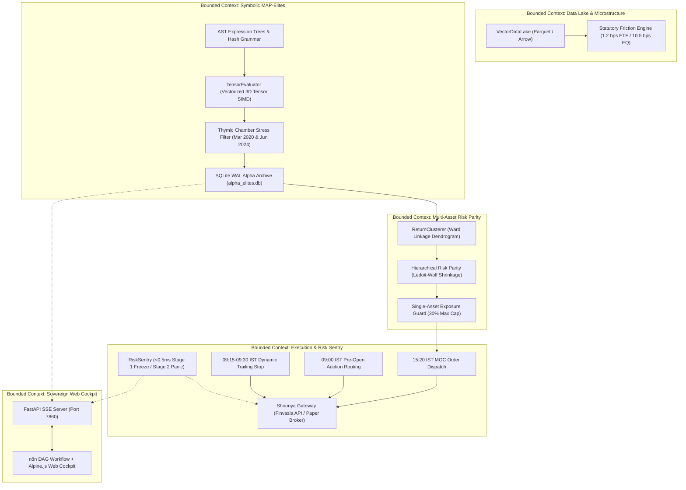

# Bio-Quant Alpha-OS: Sovereign Institutional Quantitative Architecture

Autonomous multi-asset overnight quantitative portfolio management and genetic alpha evolution platform engineered for National Stock Exchange of India (NSE) cash equities and exchange-traded funds.

---

## 1. System Architecture

Bio-Quant Alpha-OS is built upon strict Clean Architecture and Domain-Driven Design (DDD) bounded contexts. It decouples market data lakes, mathematical AST symbolic expression search, behavioral niche clustering, risk-parity capital allocation, and zero-touch broker execution.



---

## 2. Directory Structure

```
trade_new/
├── README.md                           # Institutional manual & architecture specification
├── audit/                              # SQLite WAL archives & persistent runtime telemetry
│   └── alpha_elites.db                # Resident elite champions and phenotype niche metrics
├── data/                               # Local high-performance vector data lake
│   └── lake/                           # Categorized daily OHLCV parquets (100+ NSE instruments)
│       ├── Automotive/
│       ├── Banking_Financials/
│       ├── Indices/
│       └── ...
├── scripts/                            # Operational CLI runners & background daemons
│   ├── check_secrets.py               # Credentials & environment variable validator
│   ├── connect_shoonya.py             # Shoonya Finvasia authentication tester
│   ├── import_cloud_elites.py         # Kaggle GPU candidate ingest & Thymic stress audit
│   ├── overnight_daemon.py            # Headless 24/7 automated NSE scheduling daemon
│   ├── red_team_harness.py            # 12-invariant formal stress & mathematical verification
│   ├── run_all_tests.py               # Comprehensive institutional test suite runner
│   ├── run_bankbees_overnight.py      # Single-asset BANKBEES overnight strategy runner
│   └── run_multi_asset_portfolio.py   # Multi-asset risk parity portfolio runner
├── src/                                # Core bounded contexts
│   ├── clustering/                    # Return correlation, Ward linkage, and Occam pruning
│   ├── data/                          # VectorDataLake, Parquet loader, feature engineering
│   ├── domain/                        # AST expressions, grammar, parser, canonical hashing
│   ├── evolution/                     # MAP-Elites grid, genetic mutators, and WAL store
│   ├── execution/                     # Shoonya gateway, Risk Sentry, paper trading engine
│   ├── pipeline/                      # Bankbees and multi-asset end-to-end execution pipelines
│   └── ui/                            # FastAPI server, SSE event bus, and static web app
│       ├── server.py                  # Port 7860 REST + differential SSE stream server
│       └── static/                    # Alpine.js, WebGL heatmaps, 3D Plotly, and AudioSynth
└── tests/                              # Rigorous unit & integration test coverage (80+ tests)
```

---

## 3. Quick Start

### Prerequisites
* Python 3.10+ (64-bit)
* Windows, Linux, or macOS

### Dependencies
Install core mathematical, quantitative, and server libraries:
```bash
pip install fastapi uvicorn pydantic numpy pandas scipy scikit-learn loguru pyotp requests
```

### Validate Test Suite
Verify that all system components pass validation with 100% green status:
```bash
python trade_new/scripts/run_all_tests.py
```

---

## 4. Web Cockpit Launch

Launch the sovereign n8n-style Node Cockpit Web UI on Port 7860:
```bash
python trade_new/src/ui/server.py
```
Open your browser at `http://localhost:7860`.

### Operational Workflow Decks
* **Node 1: Data Ingest Deck**: Select from 100+ NSE assets or auto-discover newly partitioned Parquet datasets from `data/lake/`.
* **Node 2: MAP-Elites Compute Deck**: Configure generation count, population size, exploration seeds, and dispatch genetic evolution.
* **Node 3: Risk Sentry Deck**: Continuous sub-millisecond watchdog monitoring statutory DP charge floors (₹15,930 MIS threshold) and emergency panic controls.
* **Node 4: Overnight Execution Deck**:
  * Set total sovereign capital (default: ₹100,000).
  * `[▶ RUN BANKBEES SCAN]`: Fast single-asset overnight alpha evaluation.
  * `[▶ RUN MULTI-ASSET SCAN]`: Full basket risk parity evaluation across BANKBEES, NIFTYBEES, GOLDBEES, JUNIORBEES, and RELIANCE.
  * Live Results Card & Table: Real-time conviction scores, target weights, allocated rupees, integer share lots, and statutory friction breakdown.

---

## 5. CLI Execution Runners

### Single-Asset Runner (BANKBEES)
Execute the overnight alpha pipeline on BANKBEES with full ASCII telemetry:
```bash
python trade_new/scripts/run_bankbees_overnight.py --capital 10000 --lookback 1y
```

### Multi-Asset Portfolio Runner
Execute risk-parity capital allocation across the core basket:
```bash
python trade_new/scripts/run_multi_asset_portfolio.py --capital 100000 --lookback 2y --threshold 0.40 --max-weight 0.30
```
Key capabilities:
* **Occam Pruning**: Eliminates duplicate AST phenotypes using return correlation distance ($\rho > 0.85$) and tree length parsimony.
* **Risk Parity**: Ledoit-Wolf analytical covariance shrinkage with Ward hierarchical linkage tree.
* **Statutory Compliance**: Exact friction deduction (1.2 bps for ETFs, 10.5 bps for equity shares).

---

## 6. Automated Headless Daemon

The overnight execution daemon runs 24/7 without human intervention on NSE trading days:
```bash
python trade_new/scripts/overnight_daemon.py --capital 100000 --dry-run
```

### Flag Options
* `--capital <float>`: Total capital to allocate (default: 100,000 INR).
* `--dry-run`: Safe simulation mode with paper execution (default: True).
* `--live`: Live broker routing to Shoonya Finvasia OMS.
* `--mode <single|multi>`: Execution mode (default: `multi`).
* `--once`: Runs a single diagnostic test cycle immediately and exits.
* `--interval <seconds>`: Loop heartbeat poll interval (default: 30s).

### Execution Windows (IST)
| Time Window (IST) | Market Phase | Action |
| :--- | :--- | :--- |
| **09:00 - 09:08** | Pre-Open Auction | Routes limit sell orders at implied auction price |
| **09:15 - 09:30** | Regular Open | Real-time trailing stop loss monitoring and dynamic profit lock |
| **09:30 - 15:15** | Intraday Hold | All capital held in cash or swept into overnight LIQUIDBEES |
| **15:15 - 15:25** | Market on Close (MOC) | Multi-asset conviction evaluation, risk parity sizing, and entry order routing |

---

## 7. Kaggle Cloud GPU Bridge

Accelerate genetic evolution using remote Kaggle T4/P100 GPUs without local compute strain:
1. Export candidate alpha formulas from cloud workers to `candidates.json`.
2. Ingest and stress-test candidates through the local **Thymic Chamber**:
```bash
python trade_new/scripts/import_cloud_elites.py --file candidates.json --ticker BANKBEES
```
3. Candidates must pass dual historical stress regimes:
   * **COVID Crash (March 2020)**: Maximum stress drawdown $\le 6.0\%$.
   * **Election Shock (June 2024)**: Preserved net positive return.
   * **Sortino Floor**: Annualized Sortino $\ge 2.0$.

Surviving candidates are atomically committed to `audit/alpha_elites.db` with WAL mode concurrency.

---

## 8. Red Team Invariant Verification

Execute formal red-team mathematical and stress invariant validation:
```bash
python trade_new/scripts/red_team_harness.py
```

### 12 Invariant Constraints
1. **Zero Future Leakage**: Purged, embargoed walk-forward cross validation enforces temporal causality.
2. **Deterministic Evaluation**: AST formulas evaluate to identical binary returns given identical input tensors.
3. **Bounded Arithmetic**: Div-by-zero, log-of-negative, and NaN/Inf cascades are safely clipped in $O(1)$.
4. **Statutory Friction Floor**: Every paper order deducts exact Indian taxes (STT, exchange turnover, SEBI charges, GST, stamp duty).
5. **Integer Lot Sizing**: Allocations round down to integer units (`floor(capital / price)`), ensuring no fractional equity orders.
6. **Single-Asset Cap**: No individual asset exceeds 30% of total portfolio equity.
7. **Two-Stage Panic Freeze**:
   * Stage 1: Atomic atomic shared memory trip in $<0.5\text{ms}$ halts outbound network requests.
   * Stage 2: Parallel async socket dispatch cancels pending orders and closes positions to 100% cash.
8. **Thread-Safe WAL**: SQLite database uses Write-Ahead Logging (`PRAGMA journal_mode=WAL`) allowing concurrent reads during ingestion.
9. **Dead-Man Switch**: UI WebSocket/SSE disconnect triggers automatic fail-safe alerts.
10. **Zero Memory Leaks**: VectorDataLake loads and releases memory partitions cleanly.
11. **Negative Equity Guard**: Portfolio drawdown limiter aborts trading if equity falls below survival threshold.
12. **Microstructure Lower-Circuit Trap**: Automatic switch to synthetic ETF hedging if an underlying stock hits circuit limits.
